# 东南大学电工电子实验中心

## 实 验 报 告

课程名称：模拟电子电路实验

实验名称：基本比例放大电路实验

院（系）：电子科学与工程学院　专业：电子科学与技术

姓　　名：zhz　　学　　号：（已隐去）

实 验 室：电子技术实验2室103　实验组别：

同组人员：　　实验时间：2026年4月9日

---

## 一、实验目的
1. 理解运放参数意义，并能正确选用运放；
2. 掌握运放构成基本比例放大电路的基本结构；
3. 掌握放大电路性能指标和电路参数的关系；
4. 掌握放大电路交、直流特性的测量方法；
5. 掌握运放最大输出电压、输出电流的特性及测量。

## 二、实验内容

1.实验要求
用运算放大器设计一个反相比例放大电路，要求其放大倍数为-10，输入电阻不
小于 10KΩ，输出电阻小于 1KΩ。
                   图 1 反相比例放大电路

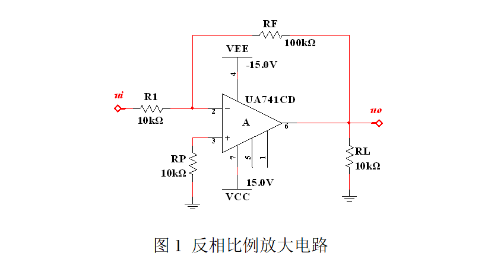

2.仿真实验
（1）测量电路的放大倍数
反相比例放大电路仿真模型图（截图）：

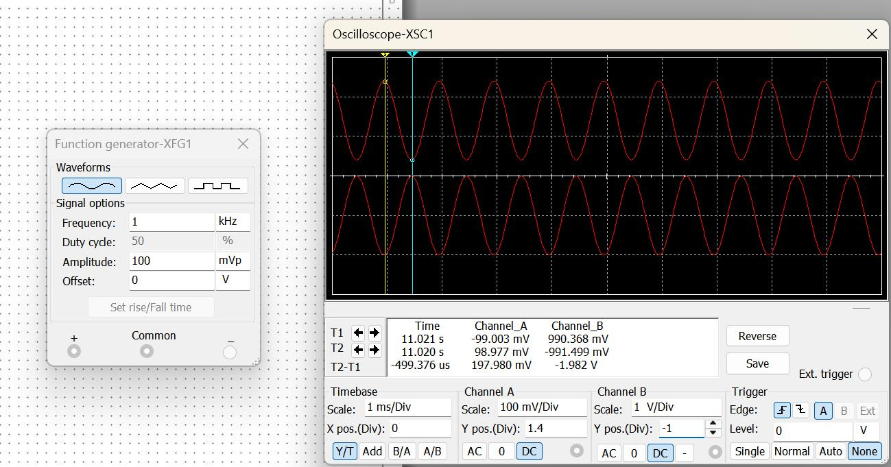
反相比例放大电路仿真波形图（截图，图中标注光标测量数据）：

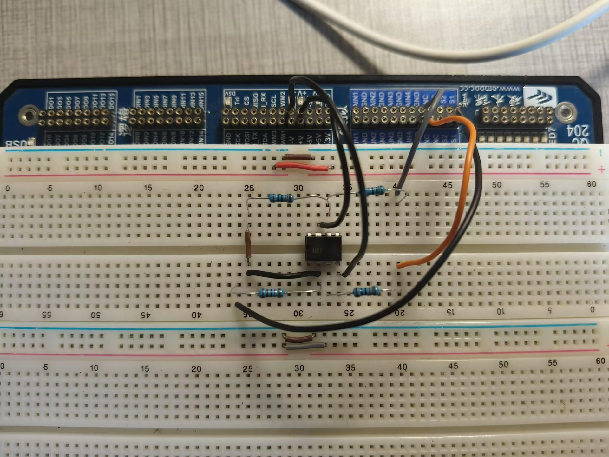

放大倍数计算：
Au=-990.368/99.003=-10.003
（2）电路性能的研究
通过改变 R1 和 RF 的阻值，运行仿真软件后，观察输入输出波形的关系，将数据
计入表格：
**反相比例放大电路的仿真实验数据表**

| R1/KΩ | RF/KΩ | 输入电压/mV | 输出电压/mV | 放大倍数(仿真) | 放大倍数(理论计算) |
|-------|-------|-------------|-------------|----------------|-------------------|
| 10 | 100 | 99.003 | -990.368 | -10.003 | -10 |
| 10 | 200 | 99.583 | -1994 | -20.023 | -20 |
| 20 | 100 | 99.454 | -493.880 | -4.966 | -5 |
| 20 | 200 | 99.460 | -987.844 | -9.932 | -10 |

3. 电路实验
电路实物图：

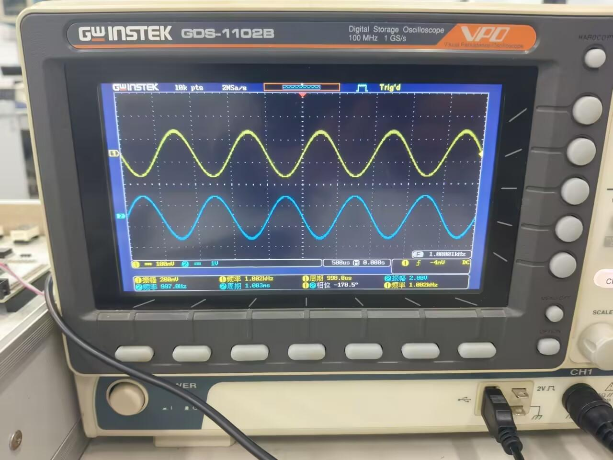
（1）直流放大性能的测量
**直流特性的测量数据表**

| 输入电压/V | 输出电压/V | 放大倍数(测量值) | 放大倍数(理论值) |
|------------|------------|------------------|------------------|
| -2 | 14.1 | -7.05 | -10 |
| -0.5 | 5.32 | -10.64 | -10 |
| 0.5 | -4.60 | -9.20 | -10 |
| 2 | -12.5 | -6.25 | -10 |
分析总结：

   注意到当输入电压为 2 或-2V 时，放大倍数严重偏离理论值-10 倍。这是因
为理论输出应为 ±20V，但运算放大器的输出电压受其供电电压限制，无法达到
理论值。因此，电压被限制在约 +14.1V 和 -12.5V，导致计算出的有效放大倍
数降低。体现了波形饱和失真现象。在±0.5V 的小信号输入下，电路增益实验
值和理论值误差很小，说明电路搭接正确，符合预期。
（2）交流放大性能的测量
**交流特性的测量数据表**

| 输入电压(mVpp) | 输出电压(mVpp) | 波形是否失真 | Au | 误差 |
|----------------|----------------|--------------|-----|------|
| 200 | 2080 | 否 | 10.4 | 4% |
| 300 | 3120 | 否 | 10.4 | 4% |
| 400 | 4120 | 否 | 10.3 | 3% |
| 4000 | 28000 | 是 | — | — |
波形记录：（具体要求依据课堂讲解）

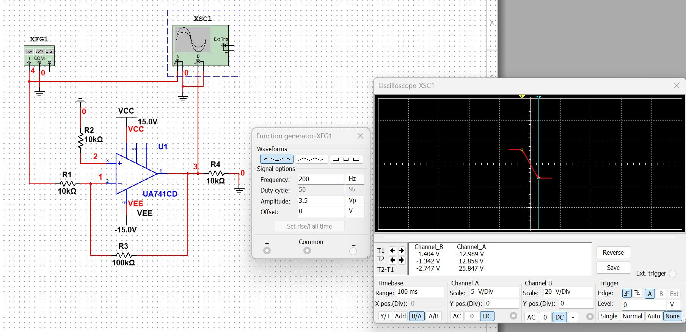
峰峰值为 200mV：

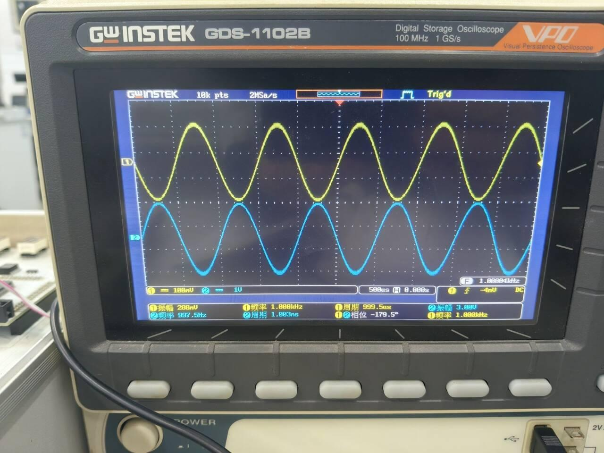

峰峰值为 300mV 时：

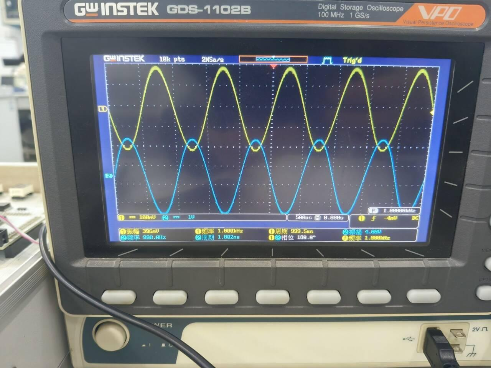
峰峰值为 400mV 时：

峰峰值为 4V 时：

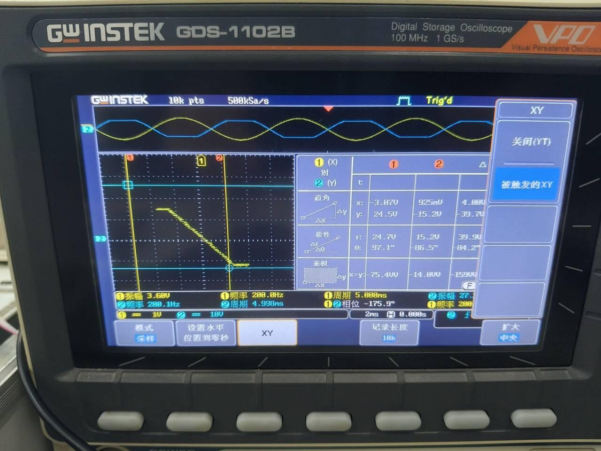
分析总结：
   实验数据表明，电路小信号作用良好：在 200mVpp 到 400mVpp 的小信号输
入范围内，放大倍数稳定在-10.4 左右，与理论值-10 存在很小的系统误差，且
非常稳定，证明电路在小信号下工作状态良好。
   大信号失真：当输入增大到 4Vpp 时，理论输出应为 40Vpp。这远远超过了
运放的供电范围，即发生了饱和失真。
（3）电压传输特性的测量

**传输特性数据表**

| 测量参数名称 | 仿真值举例(V) | 仿真值(V) | 实物测量值(V) |
|--------------|---------------|-----------|---------------|
| 输出最大电压值 Uom1 | 14.074 | 12.858 | 13.1 |
| Uom1 对应的输入电压值 Uim1 | -1.413 | -1.342 | -1.52 |
| 输出最小电压值 Uom2 | -14.115 | -12.989 | -14.4 |
| Uom2 对应的输入电压值 Uim2 | 1.441 | 1.404 | 1.12 |
| 线性区的斜率 K=ΔUom/ΔUim（增益 Au） | -28.189/2.853=-9.88 | -25.847/2.746=-9.41 | -27.5/2.64=-10.42 |
波形记录：（具体要求依据课堂讲解）

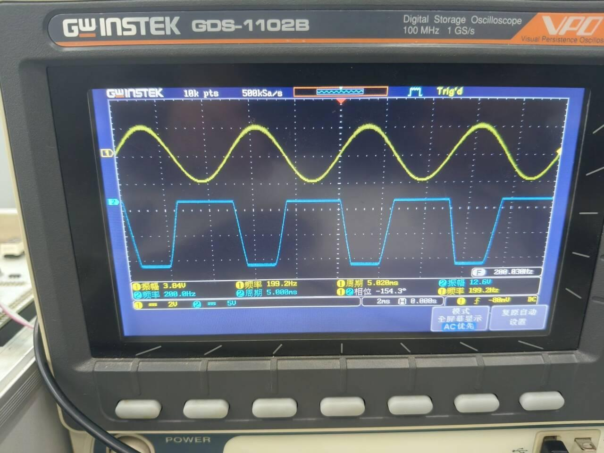
分析总结：
   输出摆幅实物测量的最大输出电压约为 +13.1V 和-14.4V，这也解释了为什
么前面直流输入±2V 时输出被限制在此范围附近。通过计算线性区的斜率得到
的增益为-10.42，与交流小信号测量的结果（10.3~10.4）高度一致。这再次确
认了电路设计和搭接的正确性。
（4）电路性能的研究
**不同的电阻取值对放大倍数的影响**

| R1(kΩ) | RF(kΩ) | 信号源Ui(mVpp) | 示波器测量Ui'(mVpp) | 示波器测量Uo(mVpp) | Au(实验值) | Au(理论值) |
|--------|--------|----------------|---------------------|---------------------|------------|------------|
| 0.1 | 1 | 200 | 146 | 1460 | -10.00 | -10 |
| 10 | 200 | 200 | 203 | 4090 | -20.14 | -20 |
| 20 | 20 | 200 | 202 | 202 | -1.00 | -1 |
| 20 | 10 | 200 | 204 | 104 | -0.51 | -0.5 |
分析总结：
   在表中，当 R1=0.1kΩ时，信号源设定为 200mVpp，但在运放反相输入端实
际测得的 Ui'只有 146mVpp。这是可能是因为信号源有内阻，当外接负载电阻 R1
较小时，信号在内阻上产生了较大的分压，导致实际输入到电路的信号衰减了。
其他三组实验数据均符合实验理论预期，说明电路搭接正确。这次实验直观验证
了设计要求输入电阻不小于 10kΩ的要求。
（5）运放特性测量
（a）最大输出电压摆幅
**最大输出电压摆幅测量表**

| 最大输出电压值 | 实验测量值(V) | 数据手册中的参数(V) |
|----------------|---------------|---------------------|
| 正向最大输出电压值 | 14.2 | 14 |
| 反向最大输出电压值 | -14.0 | -14 |

波形记录：（具体要求依据课堂讲解）

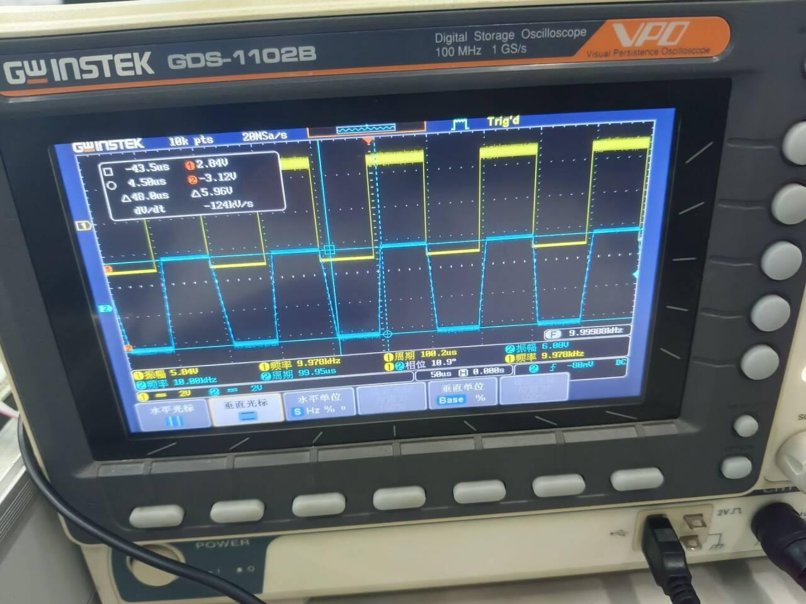
分析总结：
    实验数据验证了该芯片输出电压的最大电压值和最小电压值分别为-14V、
14V，实测值的数据符合手册值数据，说明电压选择合适以及电路设计正确。
（b）最大输出电流
**最大输出电流测量表**

| RL/Ω | 最大电压值Uomax/V | 计算最大输出电流/mA | 数据手册中的参数/mA |
|------|-------------------|---------------------|---------------------|
| 220 | 4.48 | 20.4 | 25 |
| 100 | 1.92 | 19.2 | 25 |
分析总结：
   实验数据表明，运放的最大输出电流受内部保护电路限制，约为 20mA。恒
流特性：当负载从 220Ω减小到 100Ω时，输出电流基本稳定在 19.2mA 到 20.4mA
之间，说明运放已进入恒流状态。实测电流略小于数据手册的 25mA，但是在合
适范围内，实测电流值偏小属于正常现象。
（c）转换速率 SR（压摆率）

| 类别 | 三角波峰值/V | 时间间隔 t/μS | 转换速率计算值/V/μS | 数据手册 SR/V/μS |
|------|-------------|--------------|-------------------|-----------------|
| 仿真值举例 | 9.946 | 20.446 | 0.49 | 0.5 |
| 仿真值 | 9.559 | 19.351 | 0.49 | 0.5 |
| 实物测量值 | 5.96 | 9.50 | 0.62 | 0.5 |
波形记录：（具体要求依据课堂讲解）

分析总结：
   实测 SR 为 0.62 V/μs，与仿真值（0.49 V/μs）和数据手册典型值（0.5 V/
μs）量级一致。SR 实测值略高可能源于测量读数误差或具体芯片的差异以及环
境有关，实测值略高于手册值，但在合理范围内。

## 三、实验总结
  本次实验围绕反相比例放大电路的设计、仿真与测试展开，深入探究了集成
运算放大器在实际应用中的特性。通过理论计算、Multisim 仿真和实物电路测
试三个环节的对比，加深了对运放参数物理意义的理解。
1. 电路基础性能验证
    实验基于运放设计了增益为-10 的反相比例放大器。仿真结果显示，在标准
参数下，电路增益为-10.003，与理论计算高度吻合，验证了在低频小信号下的
准确性。实物测试中，在 200mVpp 到 400mVpp 交流小信号输入下，实测增益稳定
在 10.3~10.4 倍，存在约 4%的系统误差线性度良好，满足设计要求。
2. 运放非理想特性的观察与分析
    本次实验最重要的收获在于直观地观测到了运放由理想模型转向实际应用
时的诸多限制，比如输出饱和限制：在直流特性测试中，当输入电压达到±2V
时，理论输出应为±20V，但受限于±15V 供电电压，输出被限制在+14.1V 和
-12.5V。界定了电路的线性动态范围。输出电流驱动能力：在最大输出电流测试
中，当负载电阻从 220Ω降至 100Ω时，输出电压从 4.48V 骤降至 1.92V。这表
明运放达到了约 20mA 的输出电流极限。转换速率(SR)：实测 SR 约为 0.62V/μs，
与手册典型值 0.5V/μs 基本一致，反映了运放对信号变化速度的响应上限。
3. 电路参数对性能的影响
    通过改变 R1 和 RF 的取值实验，验证了反相比例放大器的增益公式
Av=−RF/R1。当 R1 取值过小（0.1kΩ）时，由于信号源内阻的分压效应，实际输
入到反相端的电压 Ui 发生了明显衰减。这一现象有力地证明了反相放大电路输
入阻抗等于 R1 的结论，所以在设计电路时需满足输入电阻不小于 10kΩ。
4. 误差分析与总结

  仿真数据与实物测量值的差异主要源于：实物电阻的标称误差、运放芯片的
输入失调电压以及测量仪器的测量误差。虽然存在上述因素，但电路的整体表现
依然符合理论预期。通过本次实验，我不仅掌握了基本比例放大电路的设计与调
试方法，更学会了如何通过数据去反推运放内部的工作机理。这为后续进行更复
杂的模拟电路系统设计奠定了坚实的实践基础。

## 四、参考资料
[1] 黄慧春、堵国樑.模拟电子电路实验[M].东南大学出版社 2024.
[2] 堵国樑.电子电路基础[M].机械工程出版社.

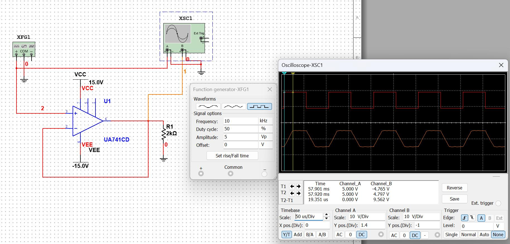
