# 东南大学电工电子实验中心

## 实 验 报 告

课程名称：模拟电子电路实验

实验名称：可控增益放大器的设计

院（系）：电子科学与工程学院　专业：电子科学与技术

姓　　名：zhz　　学　　号：（已隐去）

实 验 室：电子技术实验2室103　实验组别：

同组人员：　　实验时间：2026年5月7日

---

## 预习报告部分

可控增益放大电路预习报告

基本要求1

根据器件清单，设计一个可控增益放大电路，核心使用 μA741运放实现三档电压增益（0.1、1、10），并满足输入电阻 ≥100 kΩ、输出电阻 ≤1 kΩ 的要求。

## 一、电路方案：反相比例放大电路

采用反相放大器结构，通过切换反馈电阻改变增益。输入电阻不小于100kΩ，根据输出电阻的范围和现有器件可以画出电路图为：

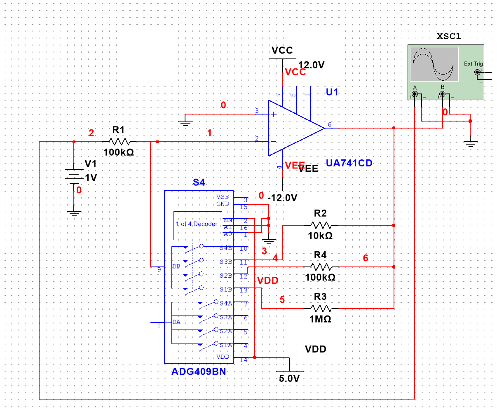

## 二、增益计算与仿真验证

增益公式：Av=−Rf/R1​​

R1 = 100 kΩ：

Rf = 10 kΩ → Av = -0.1

Rf = 100 kΩ → Av = -1

Rf = 1 MΩ → Av = -10

可控增益切换逻辑：

使用CD4052BD模拟数字开关，通过改变输入信号AB来进行切换。当AB=00时，输出线路1导通，根据Av=-R3/R1=-10可知此时实现10倍增益；当AB=01时，输出线路2导通，根据Av=-R4/R1=-1 可知此时实现1倍增益；当AB=11时，输出线路3导通，根据Av=-R2/R1=-0.1可知此时实现0.1倍增益

验证输入电阻= R1 = 100 kΩ。输出电阻≈运放输出电阻，满足≤1 kΩ。

当设置AB=00时，仿真结果如下图：

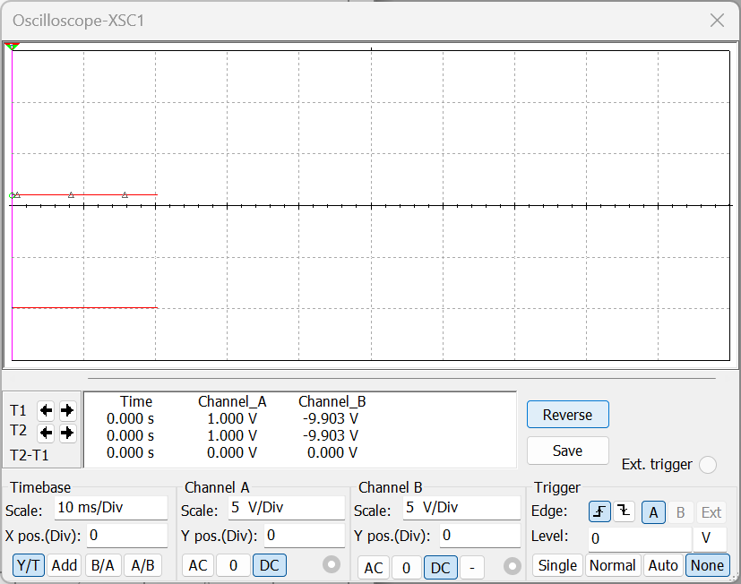

当设置AB=01时，仿真结果如图：

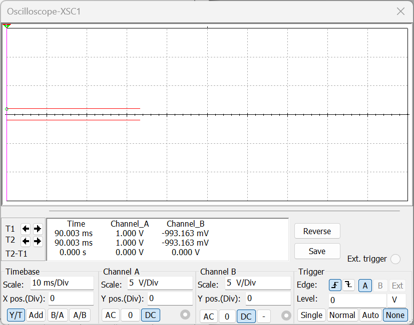

当设置AB=10时，仿真结果如图：

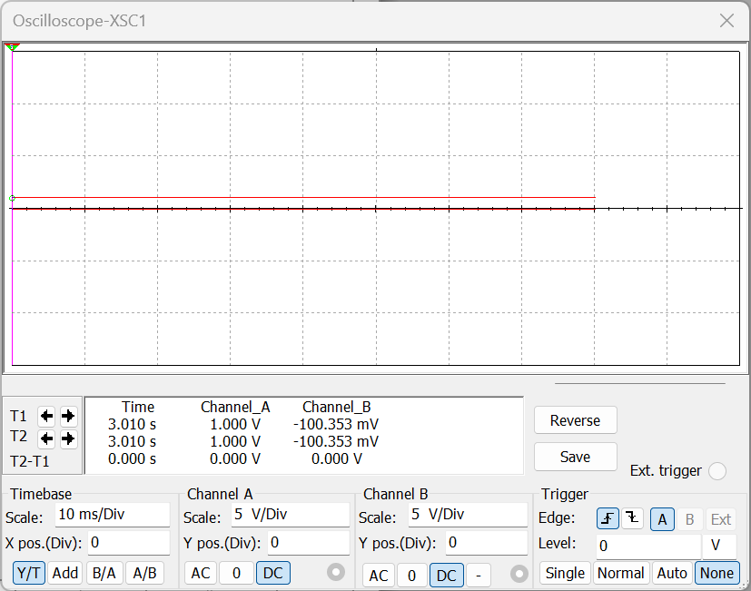

实物图搭接如下：

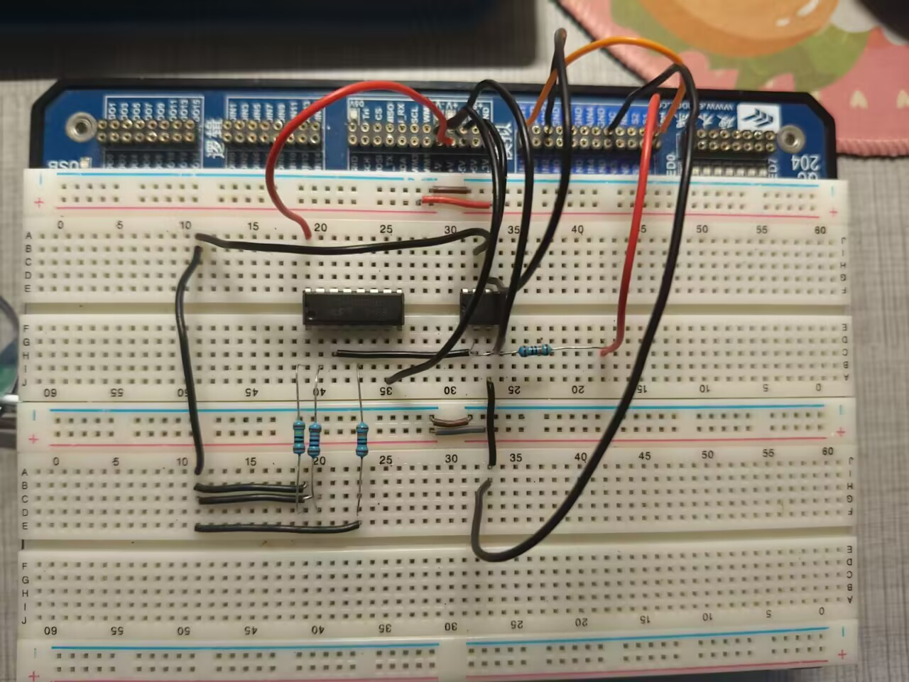

---

## 实验报告正文

      东南大学电工电子实验中心

            实 验 报 告

    课程名称：         模拟电子电路实验

实验名称：        可控增益放大器的设计
院 （系）：电子科学与工程学院专 业：电子科学与技术
姓    名：     zhz     学   号： （已隐去）
实 验 室: 电子技术实验 2 室 103 室    实验组别：
同组人员：              实验时间：2026 年 5 月    7 日
评定成绩：               审阅教师：

## 一、实验目的
1. 进一步熟悉 Multisim 软件仿真功能；
2. 掌握利用运算放大器构成可控增益放大器的基本框架及实现方式；
3. 掌握基本单元电路的设计、实验测量过程、性能分析等实验内容；
4. 掌握数字信号与模拟信号的级联、切换的方法；
5. 了解可控增益放大器的实际应用场合以及常用器件。

## 二、实验内容

1.实验要求
用运算放大器设计一个可控增益放大电路，要求其输出电阻不小于 100kΩ，输
出电阻小于 1KΩ，并且能根据输入信号幅值自动切换增益。
基本要求：
  放大器具有 0.1 倍、1 倍、10 倍三档位不同的增益，输入一个幅度为 0.1V~10V
的可调直流信号，根据输入电压的大小自动切换不同的增益值，使得放大器的输
出电压在 0.5V~5V 范围内。
  使用 CD4052 模拟开关芯片，查阅功能表设计出根据直流电压大小自动切换
不同的增益电路为：

  电压比较器两个阈值分别为 0.5V~5V，所以 R8：R9：R10=6：9：1，分别取 1kΩ、9k
Ω、6kΩ。

提高要求：
   输入一个正弦信号，频率为 1kHz，峰峰值在 0.1V~10V 范围内，根据输入
电压峰峰值的大小自动切换不同的增益值，使得放大器的输出波形峰峰值在
0.5V~5V 范围内。
   设计精密峰值检测电路，电路如下图：

   由于该峰值检测电路输入信号正弦波峰峰值，半波整流之后出现二倍关系，所以调整

电路当中电阻阻值，R8、R9、R10 分别取 1kΩ、9kΩ、22kΩ，使得电压范围在 0.25V~0.5V

之间。

   连接各个模块得到电路图：
2.仿真实验
（1）直流可控增益放大电路
放大电路仿真模型图：

放大电路仿真波形图：
0.1V、0.51V、5V、7V
（2）交流可控增益放大电路
放大电路仿真模型图：

放大电路仿真波形图：
峰峰值 0.1V、0.5V、5V、7V：
3. 电路实验
电路实物图：

（1）直流可控增益放大性能的测量
          直流可控增益电压范围测量数据表
            增益/倍    输入电压范围/V

              0.1        5~10
               1        0.49~5
              10       0.1~0.49
波形记录：
直流 110mV：

直流 500mV：
直流 4V：

直流 7V：

分析总结：
  增益切换规律：电路可根据输入直流电压大小，自动在 0.1 倍、1 倍、10 倍
三档增益间切换，实现输出稳定在 0.5V~5V 区间。输入 0.1~0.49V：增益为 10 倍，
小信号被充分放大，输入 0.49~5V：增益为 1 倍，信号等比例输出，输入 5~10V：
增益为 0.1 倍，大信号被合理衰减。Multisim 仿真与实物测量结果一致，电压
比较器 + 模拟开关 CD4052 构成的自动切换逻辑可靠，输出电压无明显失真，
满足设计指标。输入输出电阻符合设计要求。
（2）交流可控增益放大性能的测量
             交流可控增益电压范围测量数据表
                         峰峰值范围
                  增益
                          （Vpp）
                0.1       5~10
                 1        0.5~5
                10       0.1~0.5
波形记录：
输入 7Vpp:

输入 10Vpp：

输入 450mVpp：
输入 100mVpp：

输入 300mVpp：
分析总结：
  交流自动增益控制效果针对 1kHz 正弦波，电路通过精密峰值检测电路获取
信号幅值，实现与直流一致的三档自动增益切换，输出峰峰值稳定在 0.5V~5V。
分析实验现象得到：输入 0.1~0.5Vpp：增益 10 倍，输入 0.5~5Vpp：增益 1 倍，
输入 5~10Vpp：增益 0.1 倍。输出波形完整、无明显削顶失真，峰值检测电路可
以较为准确地提取幅值信息，比较器阈值设置合理，实验现象符合理论预期。因
峰值检测半波整流存在幅值二倍关系，通过调整 R8、R9、R10 阻值，使比较器工
作在合适阈值区间，保证交流控制精度。

## 三、实验中遇到的问题
    在直流可控增益电路实物测量调试中我遇到了以下问题：
1、电路搭建完成后输出信号微弱
   经过排查发现放大器并未工作，未打开电源的 VCC 与 VEE 按钮，此次失误使
得我懂得做实验过程中一定要做好前提工作，否则会起到事倍功半的效果。
2、电路功能出现部分缺失
   实验中发现 0.1V~0.5V 挡位以及 0.5V~5V 挡位输出正常，但是 5V~10V 挡位出
现直流输入，方波输出的现象，并且最大值最小值分别为缩小十倍和保持不变。
经过排查与请教老师的意见，发现原因是模拟开关在 0.1 控制开关处电阻下方面
包板发生短路，解决方法是插线的时候不要插太深。
3、电路在大电压条件下缩小效果不明显
    分析可能的原因如下：模拟开关导通电阻影响 CD4052/ADG409 内部存在导
通电阻，与反馈电阻一起改变实际增益，导致大信号档位衰减不准。比较器阈值
漂移大电压输入时，LM311 比较器阈值因电阻精度、接线电阻、电源纹波发生轻
微偏移，5V 阈值点不准，切换滞后。面包板插孔接触不良，等效电阻变大，实
际反馈比例偏离设计值。
    在交流可控增益电路实物测量调试中我遇到了以下问题：
   交流调试中出现增益切换错误，根源是精密峰值检测电路采用半波整流，输
出峰值仅为输入正弦波峰峰值的 1/2，形成二倍关系偏差。若直接使用直流电路
的电阻配比，会导致比较器阈值与实际信号幅值不匹配。实验中测得第一档切换
电压是 1V，1V 以下放大十倍，1V 以上保持不变，通过分析半波整流的峰值与峰
峰值关系，重新调整 R8、R9、R10 阻值后，峰值检测输出可正确反映输入信号
大小，交流自动增益控制恢复正常，输出稳定在设计范围内，范围测量误差更小。
   解决方法：根据半波整流峰值 = 峰峰值 / 2 的关系，重新计算比较器阈值。
将原直流阈值电阻 R8=1kΩ、R9=9kΩ、R10=6kΩ，改为 R8=1kΩ、R9=9kΩ、
R10=22kΩ。

## 四、实验总结
  本次可控增益放大器设计实验，我完成了从 Multisim 仿真到实物搭建、调
试测量的全部内容，成功实现了直流和交流信号的自动三档增益切换，让输出始
终稳定在 0.5V~5V 的目标范围，达到了实验要求。
  在直流电路中，我利用运算放大器、LM311 电压比较器和 CD4052 模拟开关，
根据输入电压大小自动选择 10 倍、1 倍、0.1 倍增益。小信号放大、大信号缩小，
输出稳定无失真，输入、输出电阻也符合指标。仿真和实际测量结果基本一致，
电路工作可靠。
  在交流电路中，为了识别正弦波的幅值，加入了精密峰值检测电路。调试时
遇到了半波整流带来的二倍关系问题—— 峰值检测只拿到峰峰值的一半，导致
增益切换不准。通过重新调整 R8、R9、R10 的电阻值，修正了阈值偏差，最终
实现了对 1kHz 正弦信号的准确自动控制，输出波形完整、无削顶、无明显失真。
  实验过程中，我也遇到了输出微弱、模拟开关附近电阻短路、大电压衰减不
明显等问题，通过检查供电、重新接线、核对电阻、排查虚接等方法逐一解决，
提升了自己的电路调试和故障分析能力。
  总的来说，这次实验让我熟练掌握了 Multisim 仿真、运放应用、模拟开关
使用、峰值检测以及数模混合电路的设计与调试方法，理解了自动增益控制的实
际意义，收获很大，基本完成了本次模电实验的全部任务。

## 五、参考资料
[1] 黄慧春、堵国樑.模拟电子电路实验[M].东南大学出版社 2024.
[2] 堵国樑.电子电路基础[M].机械工程出版社.
[3] CD4052、UA741CP、LM311 元件使用手册.

## 实验图片

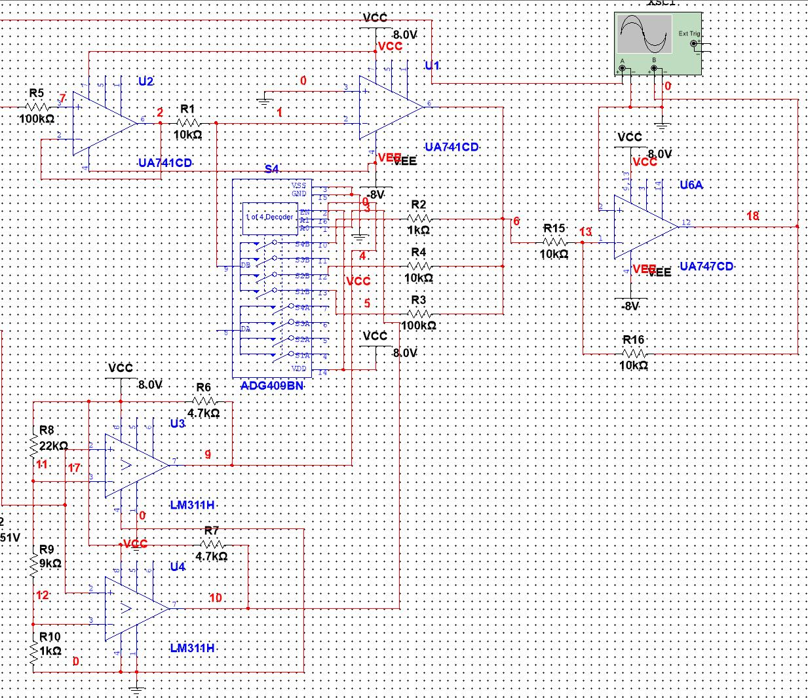

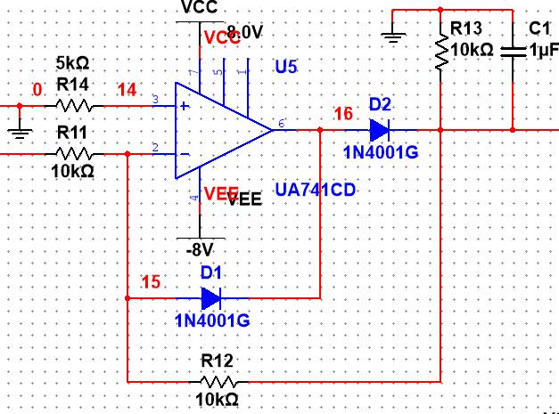

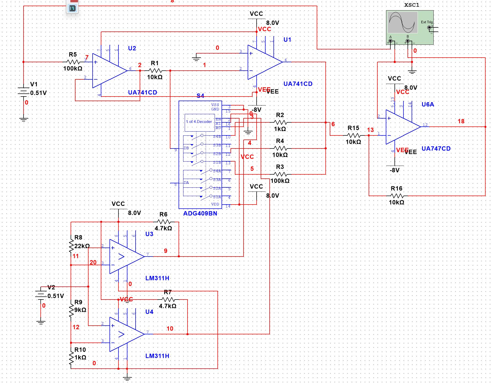

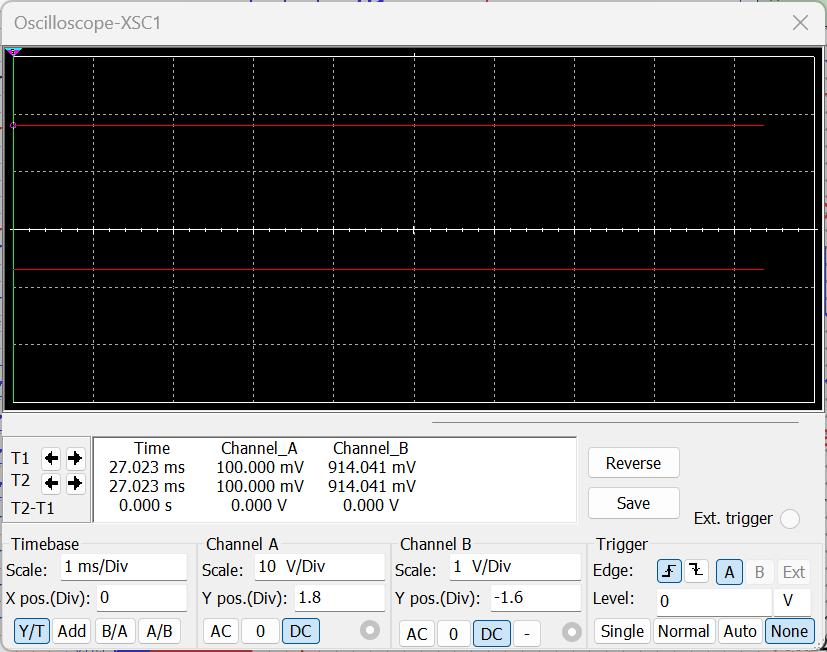

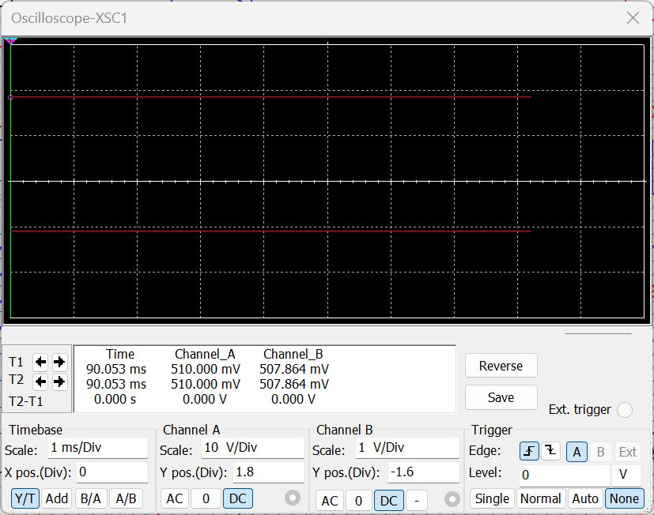

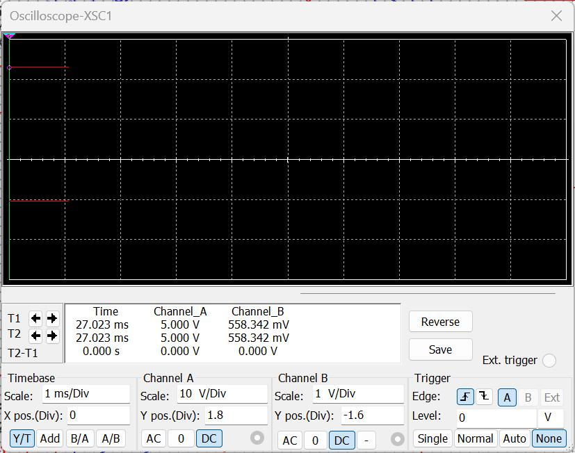

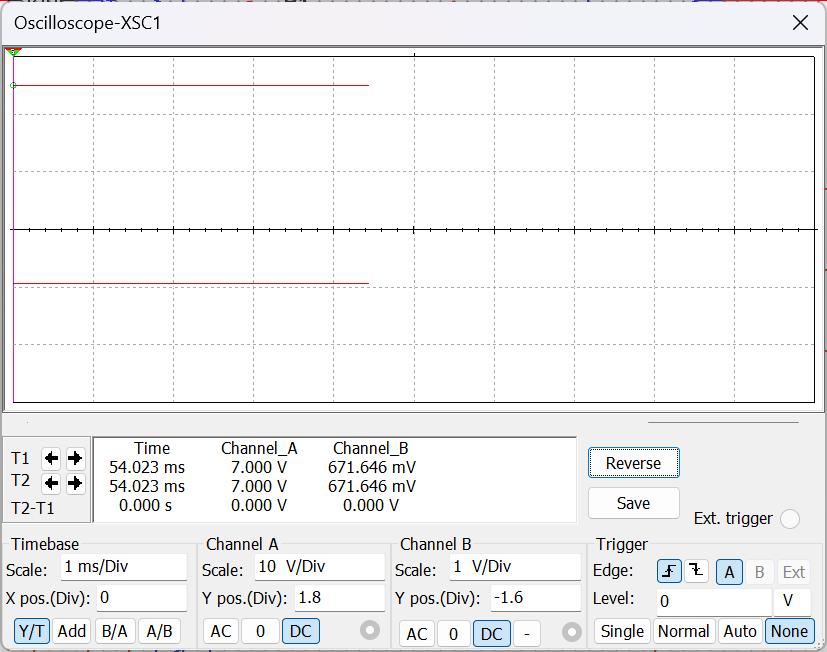

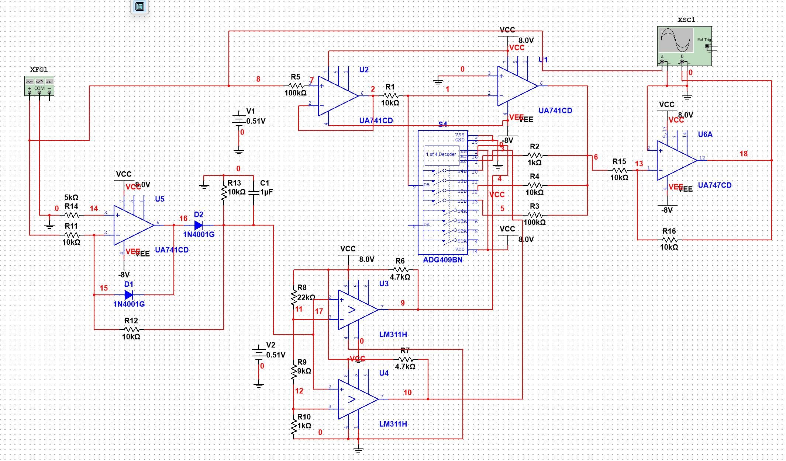

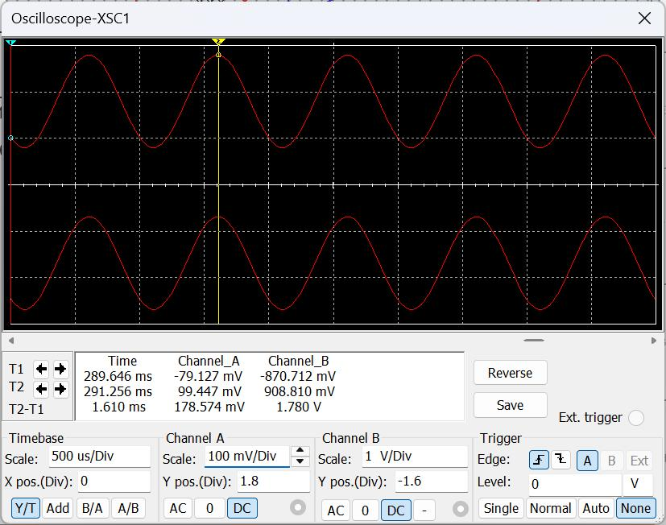

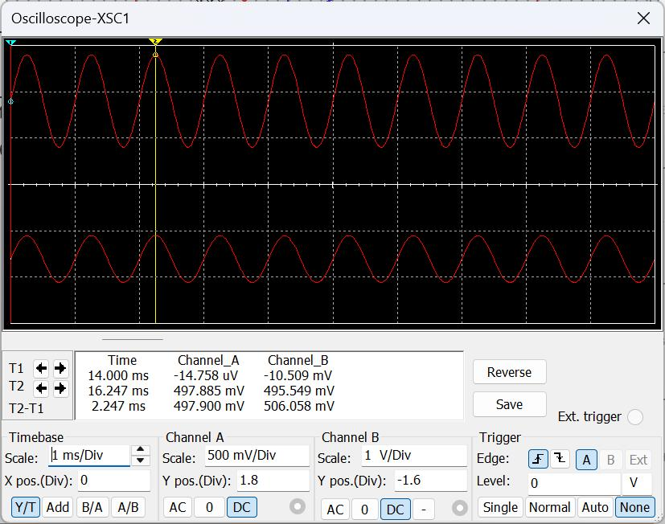

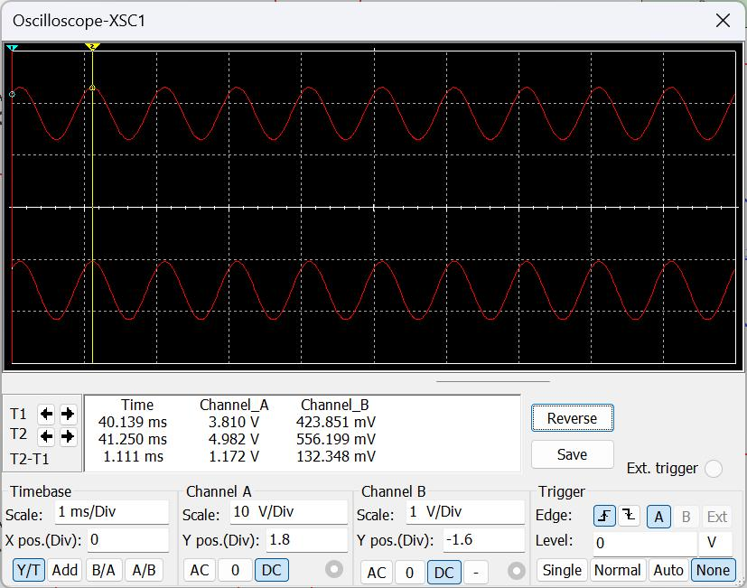

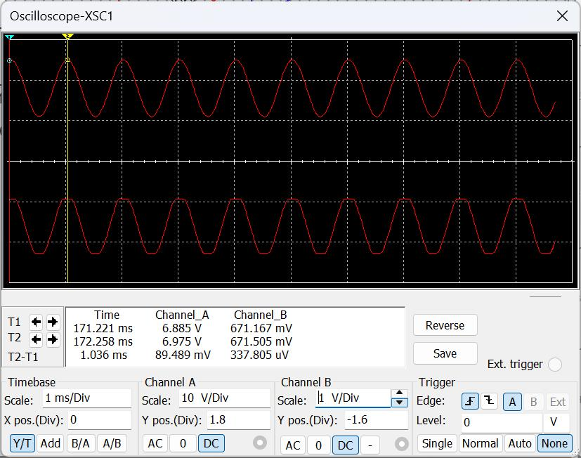

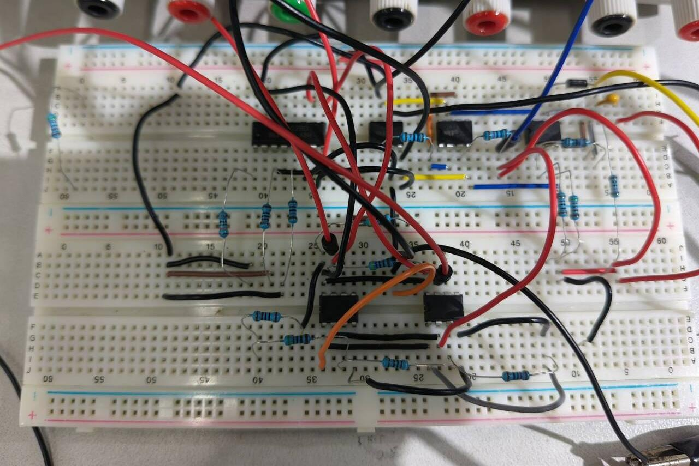

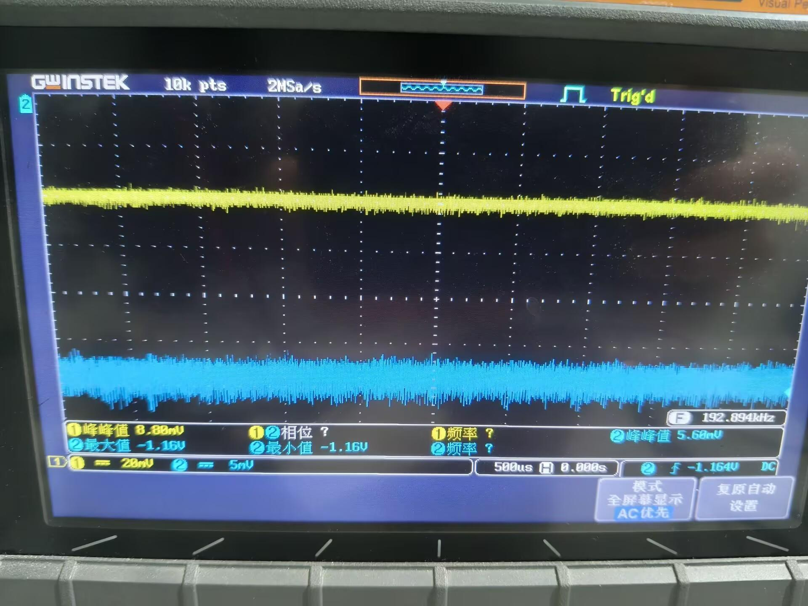

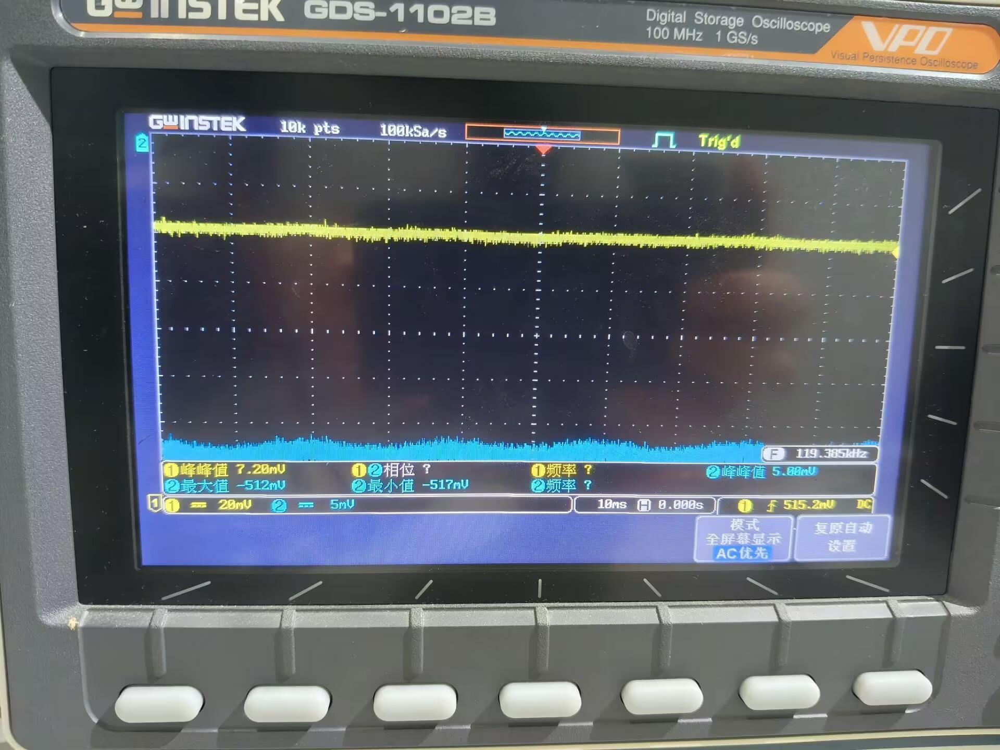

