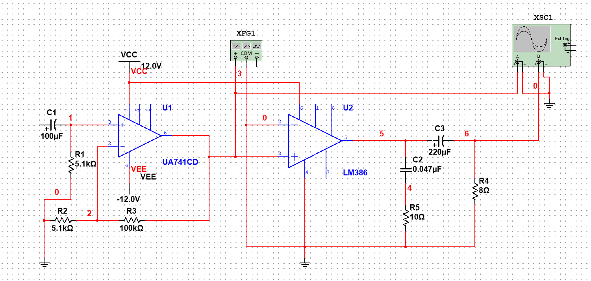
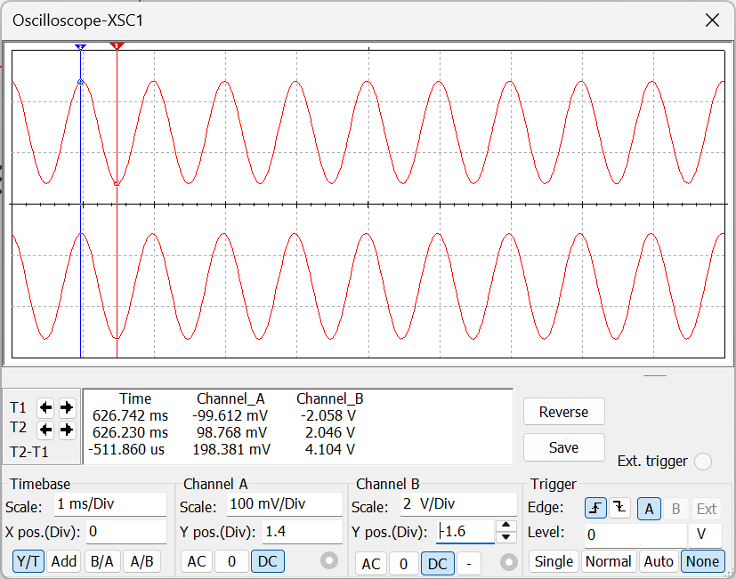
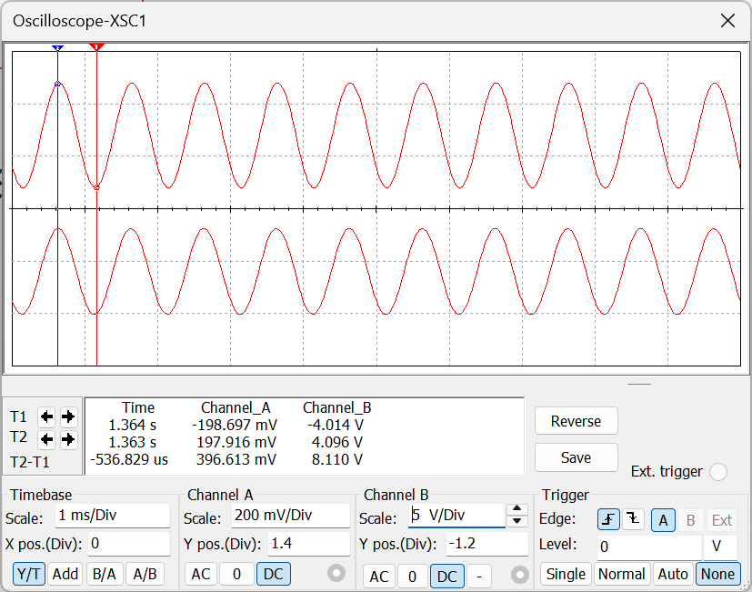
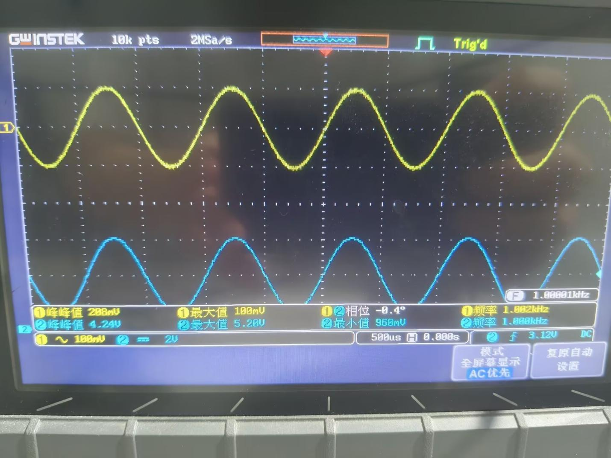
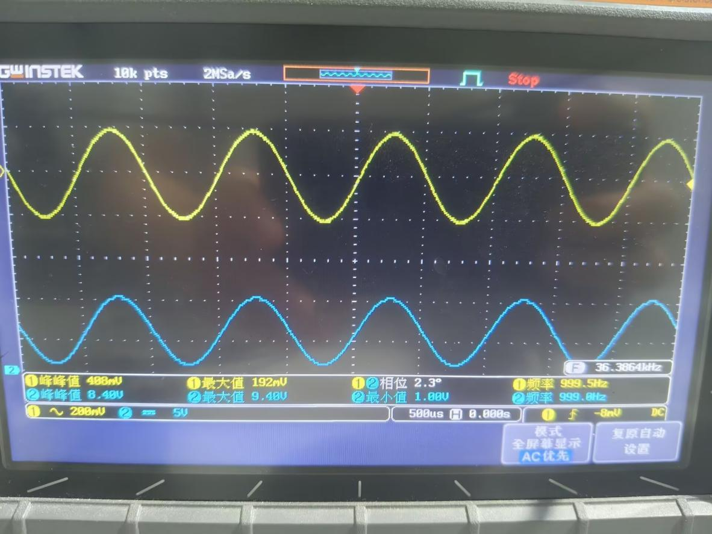
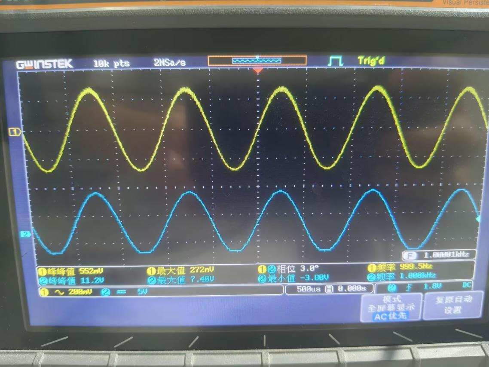
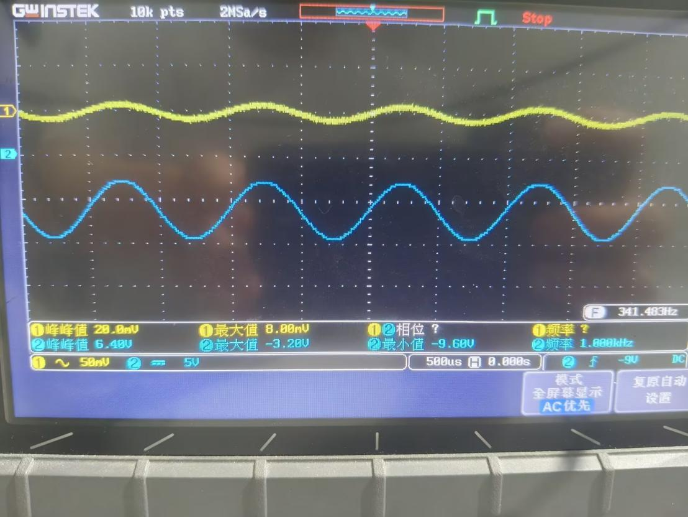
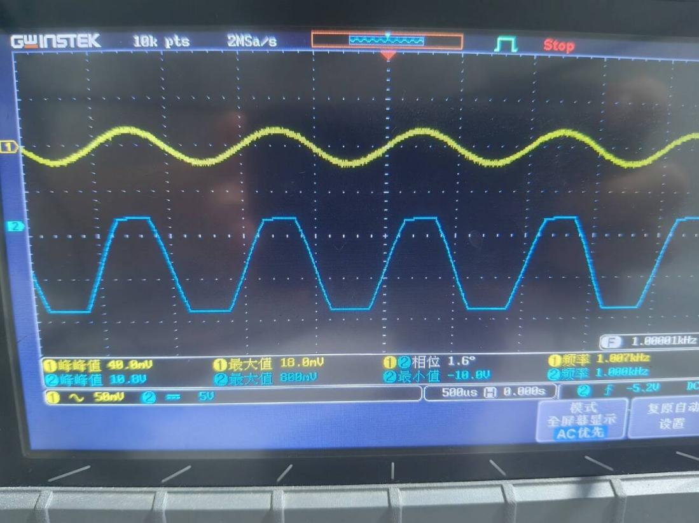

# 功率放大电路的设计实验报告

姓名：zhz　　学号：（已隐去）

> 注：报告原文未标注实验日期。

---

## 一、实验目的

1. 了解功率放大电路的基本结构和工作原理；

2. 理解OCL与OTL电路的区别与各自特点；

3. 掌握集成功放的性能参数及正确应用方法；

4. 掌握功放电路的性能指标的测量方法。

## 二、实验内容

1. 完成功放电路的同向放大电路的Multisim建模与仿真；

2. 完成电路预搭接。

## 三、仿真实验

利用运放μA741构成同向放大电路作为前置放大，级联LM386功放电路，完成从拾音器到功放的输出，构成简单的话音放大装置；功放电路Multisim仿真图：

输入为100mV时的仿真图片：

输入为200mV时的仿真图片:

## 四、电路实验

### 1. 集成功放性能的测量

**表1 功放电路参数测量记录表**

| Ui/mV | Uo/mV | 增益 | 输出功率/mW | 电源电流/mA | 电源功率/mW | 效率 |
|-------|-------|------|-------------|-------------|-------------|------|
| 100 | 2120 | 21.2 | 280.9 | 70 | 840 | 33.44% |
| 200 | 4200 | 21.0 | 1102.5 | 130 | 1560 | 70.67% |

Ui=100mV时的波形图为：

Uo=200mV时的波形图为：

实验总结：

本次实验单独测试LM386集成功放电路，分别输入100mV、200mV 正弦信号，记录输出电压、电压增益、输出功率、电源功耗及转换效率。实测电压增益稳定在21倍左右，输入信号幅值增大后，输出功率、电源消耗同步上升，电路转换效率由33.44%提升至70.67%，说明功放输出功率越大，电能转化为音频功率的效率越高。示波器观测波形无明显削顶失真，小信号输入时波形完整对称。

功放电路最大输出电压、最大输出功率的测量

**表2 功放电路最大输出电压、最大输出功率的测量记录表**

| Uim/mV | Uom/mV | 增益 | 输出功率/mW | 电源电流/mA | 电源功率/mW | 效率 |
|--------|--------|------|-------------|-------------|-------------|------|
| 276 | 5600 | 20.29 | 1960 | 180 | 2160 | 90.74% |

测量波形图为：

实验总结：

逐步增大输入信号至 276mV，电路达到最大不失真输出状态，最大输出电压 5.6V，最大输出功率 1960mW，转换效率达到 90.74%，为本电路工况下效率峰值。继续提高输入幅值会出现波形削波饱和失真，输出功率不再提升，仅增加电源无用功耗。

两级级联电路性能参数的测量

**表3 两级级联电路性能参数测量记录表**

测量波形：

Ui=10mV时的波形图：

Ui=20mV时的波形图：

实验小结：

采用运放同相放大作为前置级、LM386 后级功放两级级联，小输入信号即可获得大幅输出。输入10mV时电压测得增益320倍，输入 20mV时波形出现明显失真。两级放大结构大幅提升整体放大倍数，微弱拾音信号可驱动扬声器发声，适用于语音放大场景。示波器波形显示小信号下输出波形完整，输入20mV时输出幅值接近饱和区间，波形边缘开始出现明显失真。

## 五、实验总结

本次功率放大电路实验分为Multisim仿真、实物搭接测量两大模块，分别完成单级LM386功放、最大输出特性、μA741+LM386两级级联放大三组测试，完成功放增益、输出功率、电源功耗、转换效率等核心指标测量。

仿真阶段：使用μA741同相放大前置，搭配LM386构成语音放大电路，仿真波形与实物测试趋势一致；

单集成LM386功放特性： LM386电压增益稳定，输出功率随输入增大而升高，转换效率随输出功率提升明显增大，大信号下电能利用率更高；电路存在最大不失真输出阈值，超过后产生饱和削波失真；

两级级联：前置运放大幅提升整体放大倍数，微弱输入信号即可实现大功率输出，但两级放大易引入自激、饱和失真，；

### 整体实验故障与调试

- **无输出波形**：正负电源未开，示波器探头测量信号小；

- **波形失真**：供电电压不足，此时增大电源供电电流稳定供电电压；

- **电路自激**：增加相位补偿电容；

- **噪声杂音大**：电阻接触不良，将某些电阻引脚向上提一提；

- **仿真与实物结果不一致**：仿真元件为理想模型，实物存在误差，调试时微调反馈电阻可匹配仿真结果。

## 六、实验收获

通过本次实验我掌握了OCL/OTL功放电路原理、集成功放LM386与运放μA741的应用方法，会熟练使用示波器观测输出波形、测量功放关键性能指标，理解电压增益、输出功率、转换效率之间的变化规律，同时积累模拟放大电路自激、失真、噪声等常见故障的排查与解决思路，为音频放大电路设计与调试打下基础。

