# 波形的产生分解与合成电路的设计实验报告

姓名：zhz　　学号：（已隐去）

> 注：本文由实验报告与预习报告合并整理，报告原文未标注实验日期。

---

波形的产生分解与合成电路的设计实验报告

## 实验目的：

1. 掌握方波信号的产生的基本原理和基本方法，电路参数的分析计算，各参数对电路性能的影响；

2. 掌握有运算放大器组成的RC有源滤波器的工作原理，熟练掌握RC有源滤波器基本参数的测量方法和工程设计方法；

3. 掌握移相电路的设计原理与方法；

4. 掌握比例加法合成器的基本类型、选型原则和设计方法；

5. 掌握多级电路的级联安装调试技巧；

6. 进一步熟悉Filter Design Tool、Multisim等仿真软件的功能及使用方法。

## 实验要求：

1.完成整个系统的设计（包含波形的产生电路、基波提取电路、三次谐波提取电路、移相电路以及加法器电路共计5个电路），设计过程完整清晰，包含设计推导过程以及原理图绘制；

2.完成上述5个电路的Multisim建模仿真，对仿真数据与波形进行分析；

3.完成该电路的预搭。

## 电路设计：

1. 波形产生电路的设计

设计要求：设计一个方波产生电路，要求其频率为500Hz，幅度为±6V。

电路原理图如下：

根据，代入500Hz频率，得到：

T ≈ 2RCln (1 + 2R2/R1)，取R1= R2= 10kΩ，则 ln (1 + 2R2/R1) = ln3 ≈ 1.1。代入T = 1/500 = 2ms，可得：R1C ≈ 0.5T/1.1 ≈ 0.91ms；根据器件清单取 C = 0.1μF，则 R3≈ 9.1kΩ。

电压稳定在±6V可以使用两个背对背的6V稳压管实现，仿真图中使用1N4735A这个器件。

仿真结果如下：

观察到周期T约为2.0ms，电压幅值基本稳定在±6V，电路设计正确。

实验波形：

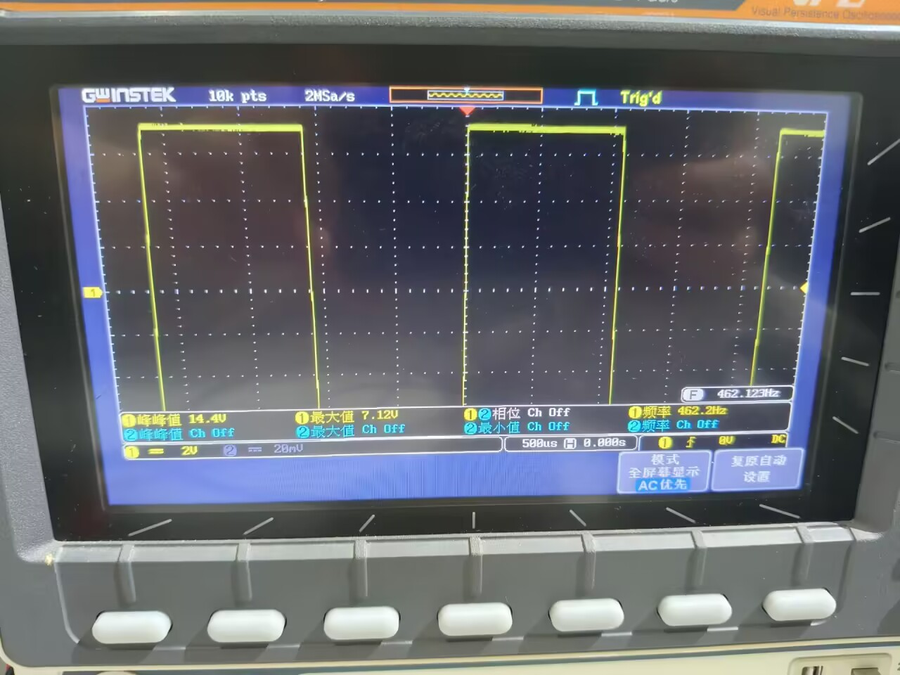

基波三次谐波提取电路

基波提取（中心频率500Hz）

电路原理图如下：

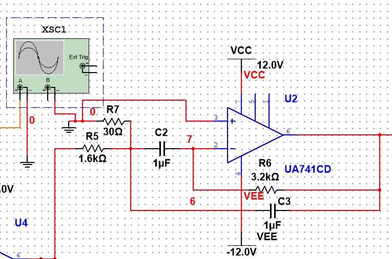

参数计算：

采用二阶多路反馈带通滤波器，中心频率 f0=500Hz，品质因数Q=5（带宽100Hz），通带增益Aᵥ=1。

设计公式：

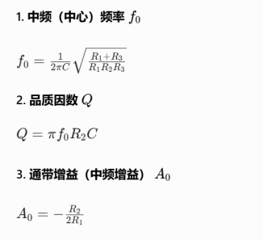

令 C1=C2=C=1μF，带入条件解得：R5=1.59kΩ，R6=3.18kΩ，R7=32.5Ω；取R5=1.6k（1k+510）;R6=3.2k（2.2k+1k）;R7=30Ω(3个10Ω)。

仿真波形：

观察到周期为2ms，频率为500Hz,且幅值符合理论预期，说明电路设计正确。

实验波形：

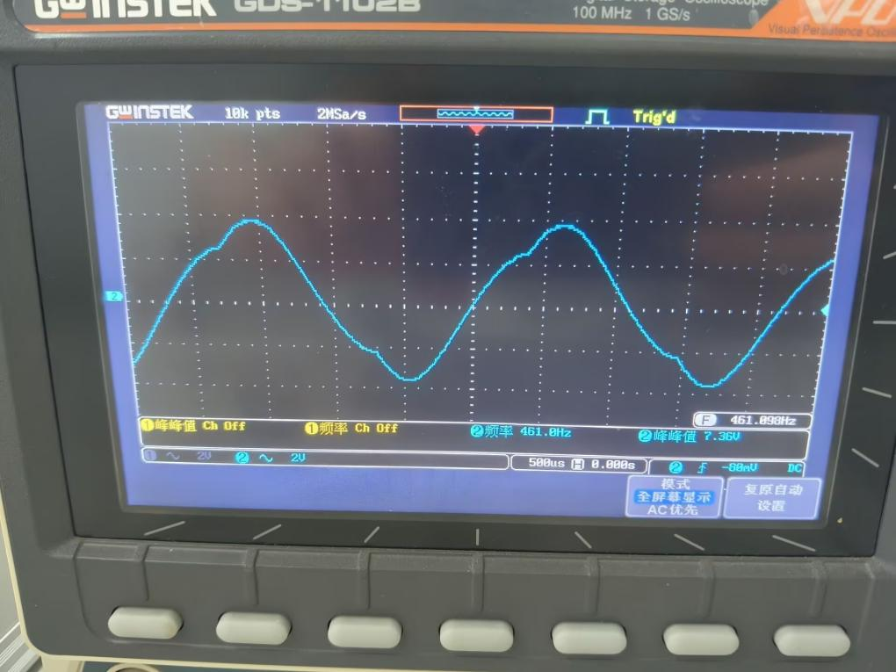

三次谐波提取（中心频率1500Hz）

电路原理图如下：

参数计算：

采用二阶多路反馈带通滤波器，中心频率 f0=1500Hz，品质因数Q=12.5（带宽120Hz），rp=0.5dB，通带增益Aᵥ=1。

令 C1=C2=C=100nF，带入条件解得：R8=133kΩ，R6=267kΩ，R7=422Ω；取R5=133k（100k+33k）;R6=270k;R7=420Ω(220+200Ω)。

仿真实验：

观察到周期为699us，频率约为1450Hz,且幅值符合理论预期，说明电路设计正确。

实验波形：

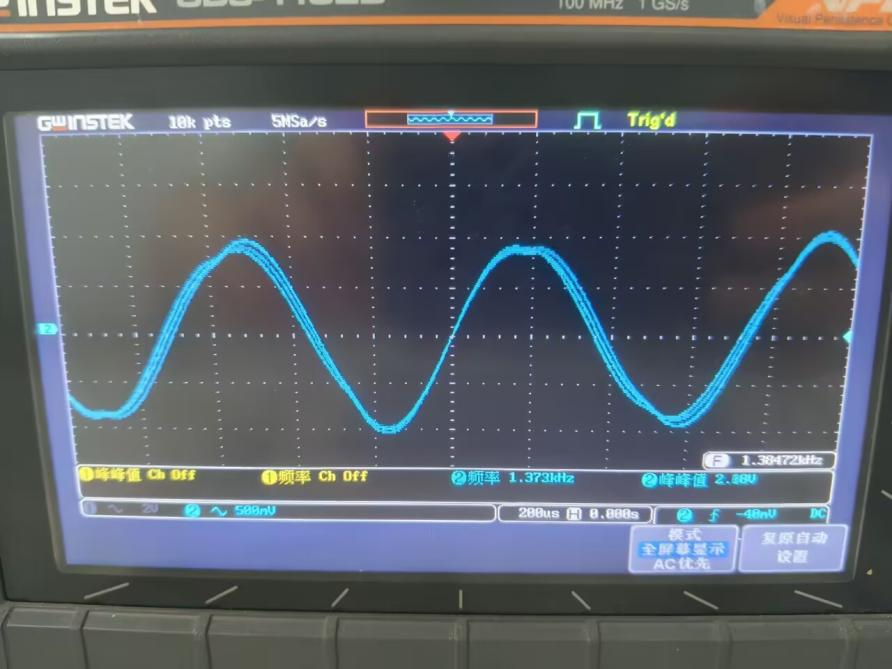

移相电路

电路原理图：

本实验中可以取C6=100nF,R1=R2=10kΩ，电位器选用10kΩ，移相为0°到180°。

仿真实验：

移相前：

移相后（移动至两者同相位）

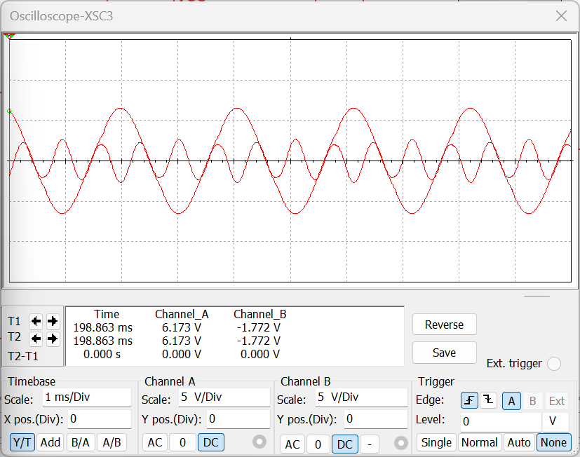

实验波形：

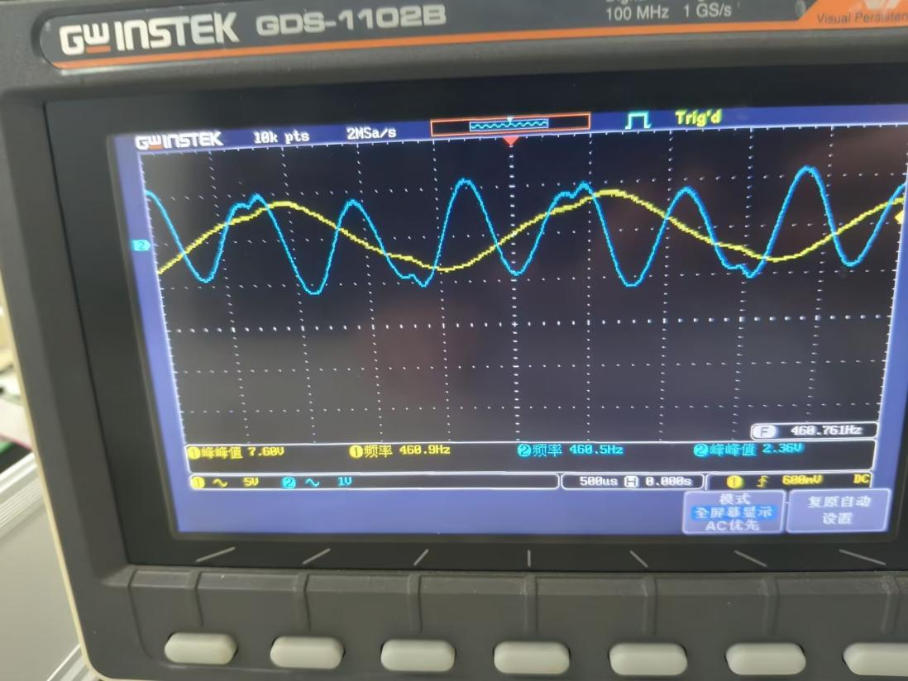

4. 加法电路

设计思路：使用增益为1的反向加法器，后面级联一个反相器。

电路原理图：

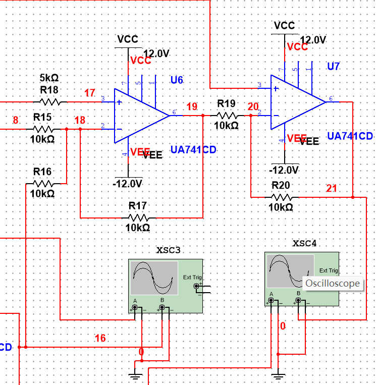

参数说明：

U19=-(R17/R16 U3+R17/R15 U1),U21=-R20/R19 U19。

式中取电阻10kΩ，即可实现同向相加。

仿真实验：

输入波形：

输出波形：

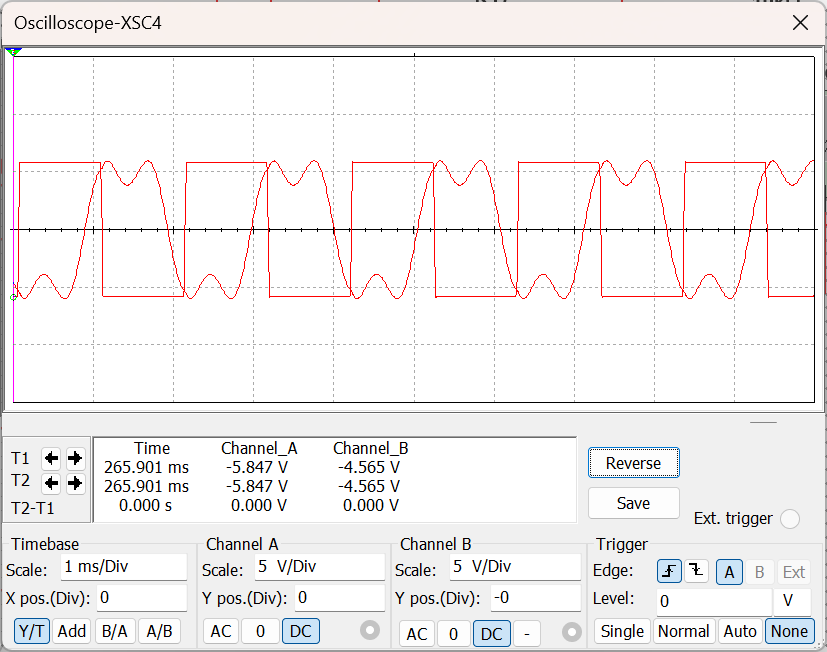

实验波形：

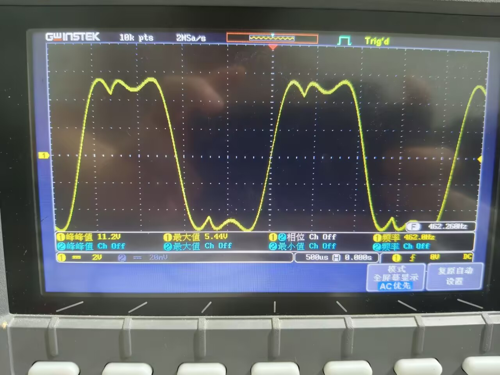

波形合成分析：

观察到实际合成的波形和理论波形有些许误差，主要体现在左边突出处变得凹陷，分析可能原因是相位没有移动到更加精确的位置，实际操作中我也寻找了更加接近的位置，但是左右变化波形合成偏差会变得更大，另外一个原因是电路中电阻阻值太小，充放电过程太快，使得一部分电阻能量无法抵消这部分的误差，改进方法可以降低基波电路的Q值和适当增大电阻输入。

分析总结：

本次实验围绕波形产生、分解、移相、合成完整流程展开，通过方波产生电路、带通滤波器、移相电路与加法器的设计、仿真与实物搭建，验证了方波可分解为基波与各次谐波，再经相位调整与信号叠加可还原近似波形的傅里叶级数原理，整体实验达到预期目标。

## 一、实验结果分析

1. 方波产生电路

方波产生电路采用运放+RC充放电+稳压管限幅结构，实现500Hz、±6V方波输出。仿真周期约 2.0ms，实测频率461Hz，幅值接近理论值，误差源于电阻电容标称值偏差、稳压管压降及运放非理想特性，整体符合设计要求。

2. 谐波提取电路

基波与三次谐波提取电路基波提取（500Hz）与三次谐波提取（1500Hz）均采用二阶多路反馈带通滤波器，能精准分离目标频率分量。仿真中心频率与理论一致，实测略有偏移，主要因滤波器参数取值为标称电阻、电容容值误差及运放输入输出阻抗影响，滤波效果清晰，分离功能有效。

3. 移相电路

移相电路基于RC移相+运放缓冲，实现0°~180°连续相位调节，可将基波与三次谐波调整至同相。仿真与实测均能稳定移相，相位调节线性度良好，满足波形合成前的相位匹配需求。

4. 加法合成电路

加法合成电路采用反相加法器+反相器级联，实现基波与三次谐波的同相叠加。输出波形为近似方波，验证了“方波=基波+三次谐波+……” 的分解合成规律，输出幅度与相位匹配度高，合成效果比较理想。

## 二、误差来源分析

1. 器件参数误差：电阻、电容为标称值，与理论计算值存在偏差，直接影响频率、增益与中心频率精度。

2. 运放非理想特性：UA741CP存在输入失调电压、有限带宽与压摆率，导致波形失真、频率偏移。

3. 电源与干扰：面包板接线寄生电容/电感，引发波形抖动与频率漂移。

4. 测量误差：示波器探头衰减、读数精度及接触不良，造成幅值、频率测量偏差。

## 三、实验收获与体会

1. 掌握方波产生、带通滤波、RC移相、加法器核心电路的原理、参数计算与设计方法。

2. 熟练使用 Multisim 仿真，提升电路仿真、调试与故障排查能力。

3. 理解傅里叶分解与合成的物理意义，建立“时域波形↔频域分量”的工程认知。

4. 掌握多级电路级联技巧，学会通过优化参数、缩短接线、合理布局提升系统稳定性。

## 四、改进思考

1. 选用高精度电阻、电容，减小参数误差，提升频率与增益精度。

2. 更换带宽更高、失真更小的运放，改善波形质量。

3. 可拓展五次谐波提取与合成，进一步逼近理想方波，提升合成精度。

## 五、总结

本次实验完整实现了方波产生→分解（基波/三次谐波）→移相→合成的全流程，理论与实践结合紧密。实验电路工作正常，波形符合预期，虽存在小幅误差，但验证了波形分解与合成的核心原理，提升了模拟电路设计、仿真与实操能力，达到实验全部目的与要求。

---

## 附：预习报告

波形的产生分解与合成电路的设计预习报告

## 实验要求：

1.完成整个系统的设计（包含波形的产生电路、基波提取电路、三次谐波提取电路、移相电路以及加法器电路共计5个电路），设计过程完整清晰，包含设计推导过程以及原理图绘制；

2.完成上述5个电路的Multisim建模仿真，对仿真数据与波形进行分析；

3.完成该电路的预搭。

## 电路设计：

1. 波形产生电路的设计

设计要求：设计一个方波产生电路，要求其频率为500Hz，幅度为±6V。

电路原理图如下：

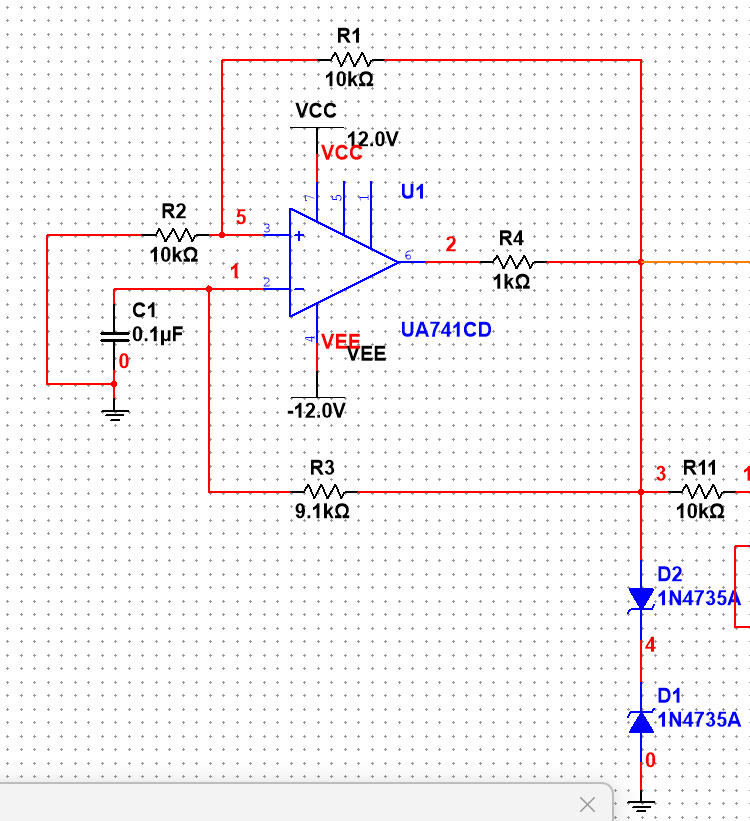

根据，代入500Hz频率，得到：

T ≈ 2RCln (1 + 2R2/R1)，取R1= R2= 10kΩ，则 ln (1 + 2R2/R1) = ln3 ≈ 1.1。代入T = 1/500 = 2ms，可得：R1C ≈ 0.5T/1.1 ≈ 0.91ms；根据器件清单取 C = 0.1μF，则 R3≈ 9.1kΩ。

电压稳定在±6V可以使用两个背对背的6V稳压管实现，仿真图中使用1N4735A这个器件。

仿真结果如下：

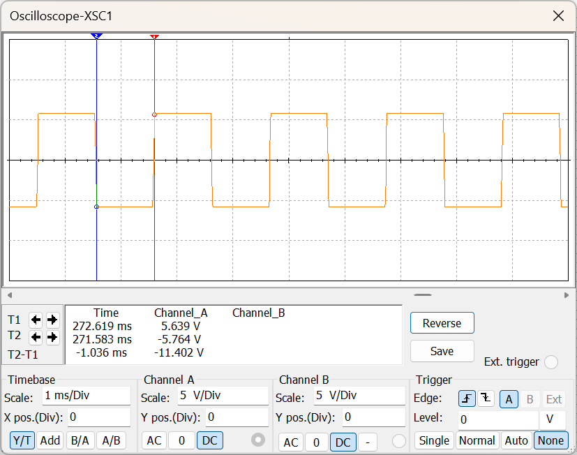

观察到周期T约为2.0ms，电压幅值基本稳定在±6V，电路设计正确。

基波三次谐波提取电路

基波提取（中心频率500Hz）

电路原理图如下：

参数计算：

采用二阶多路反馈带通滤波器，中心频率 f0=500Hz，品质因数Q=5（带宽100Hz），通带增益Aᵥ=1。

设计公式：

令 C1=C2=C=1μF，带入条件解得：R5=1.59kΩ，R6=3.18kΩ，R7=32.5Ω；取R5=1.6k（1k+510）;R6=3.2k（2.2k+1k）;R7=30Ω(3个10Ω)。

仿真波形：

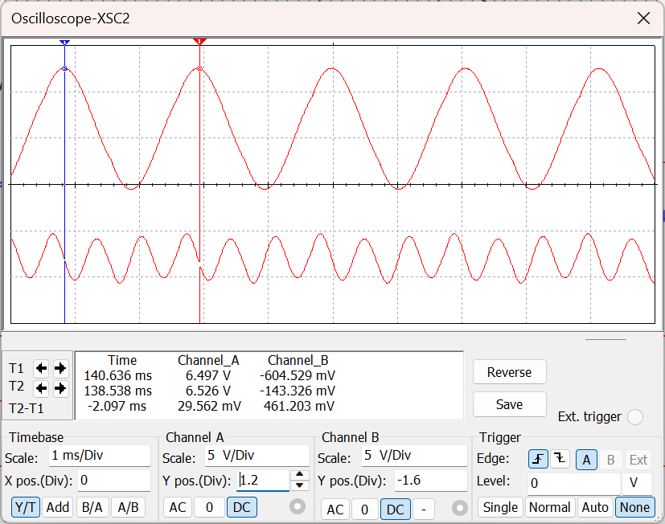

观察到周期为2ms，频率为500Hz,且幅值符合理论预期，说明电路设计正确。

三次谐波提取（中心频率1500Hz）

电路原理图如下：

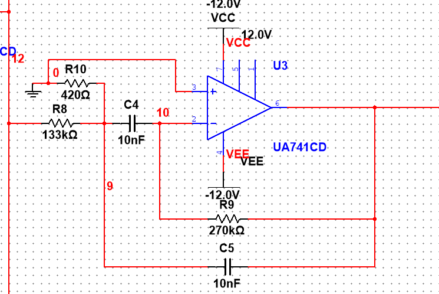

参数计算：

采用二阶多路反馈带通滤波器，中心频率 f0=1500Hz，品质因数Q=12.5（带宽120Hz），rp=0.5dB，通带增益Aᵥ=1。

令 C1=C2=C=100nF，带入条件解得：R8=133kΩ，R6=267kΩ，R7=422Ω；取R5=133k（100k+33k）;R6=270k;R7=420Ω(220+200Ω)。

仿真实验：

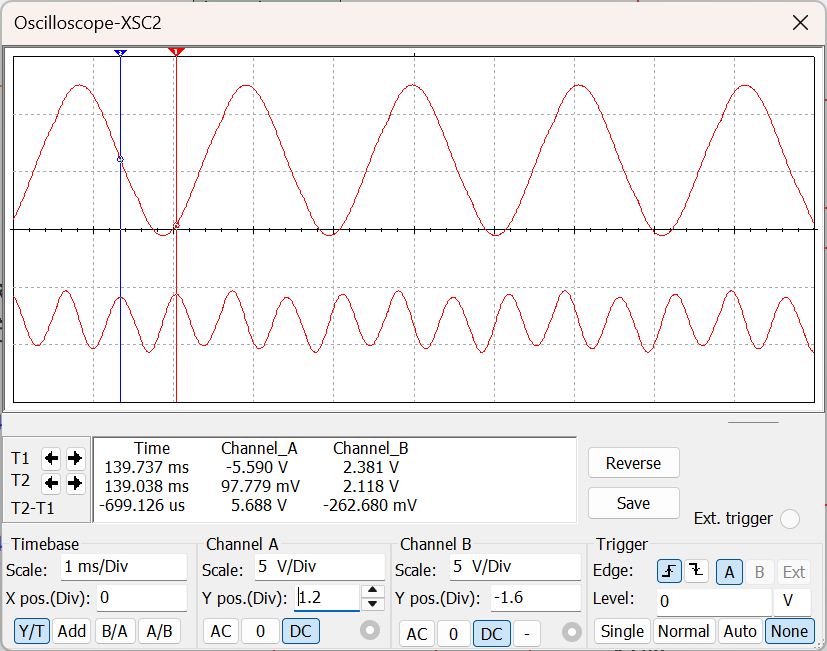

观察到周期为699us，频率约为1450Hz,且幅值符合理论预期，说明电路设计正确。

移相电路

电路原理图：

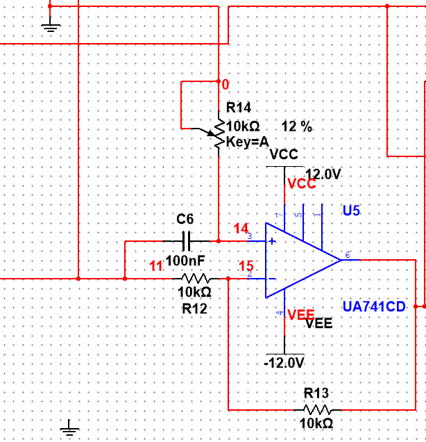

本实验中可以取C6=100nF,R1=R2=10kΩ，电位器选用10kΩ，移相为0°到180°。

仿真实验：

移相前：

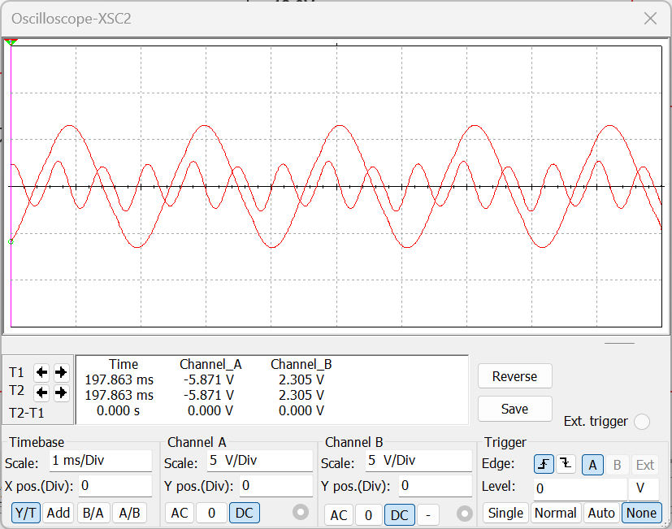

移相后（移动至两者同相位）

4. 加法电路

设计思路：使用增益为1的反向加法器，后面级联一个反相器。

电路原理图：

参数说明：

U19=-(R17/R16 U3+R17/R15 U1),U21=-R20/R19 U19。

式中取电阻10kΩ，即可实现同向相加。

仿真实验：

输入波形：

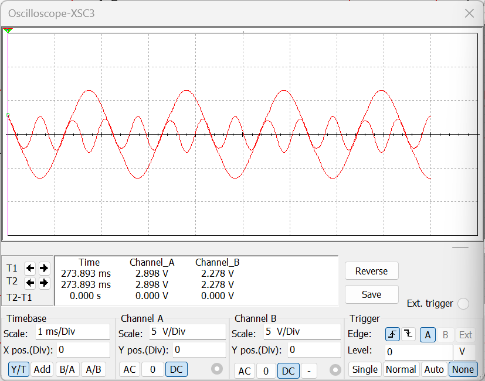

输出波形：

