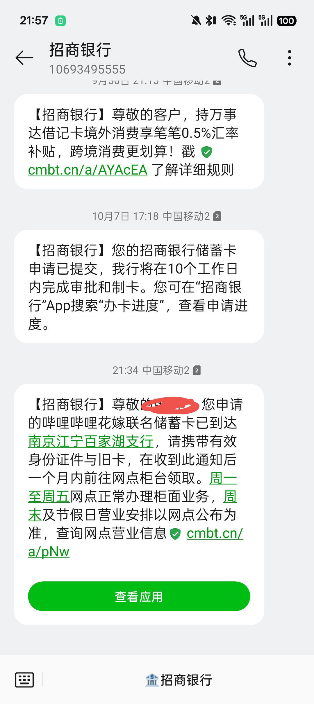
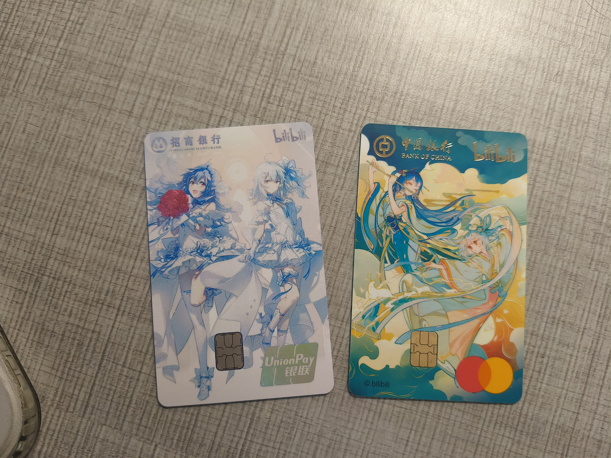

# 文章内容

先交代一下背景：上周收到短信说卡到网点了，我兴冲冲杀过去，结果——没带身份证。

柜员小姐姐保持着职业微笑：「先生，没有身份证我们没办法给您发卡。」再一看表，支行 16:30 关门。我站在门口，像个没交作业被赶出教室的小学生。

很巧的是晚上招行的联名花嫁卡也下来了，五天真是神速啊，正好顺手一起拿

一天后，也就是昨天，身份证揣兜里揣得死死的，趁中午短休时间，两张卡，一次拿下！

## 第一张：中银 × b 站万事达 —— 干活的卡

这张是冲着「海外支付」去的。万事达通道，境外网站、各种订阅扣款就靠它了。

说实话，办它的理由特别务实：VPS 续费、域名续费、时不时冒出来的境外小额订阅，以前总要绕来绕去。现在一张万事达在手，全球 200 多个国家和地区的商户都能刷，省心。

卡面是 b 站联名设计，低调里带点二次元味，不会太社死，拿得出手。

## 第二张：招行 × b 站纯白花嫁 —— 好看的卡

如果说中银那张是干活的，这张就是纯粹的颜值消费。

纯白卡面，2233 娘的花嫁装，拿到手第一反应是：这哪是银行卡，这是收藏品。白色卡身干干净净，阳光下看还有点质感，刷卡的时候掏出来，收银员都得多看两眼。

至于权益？不重要。好看，就是它最大的权益。

## 总结

一对卡，一个负责征战海外，一个负责貌美如花，分工明确，配合默契。

唯一的问题是：卡是拿下了，额度是银行的，账单可是我的。下个月的账单日，咱们走着瞧。