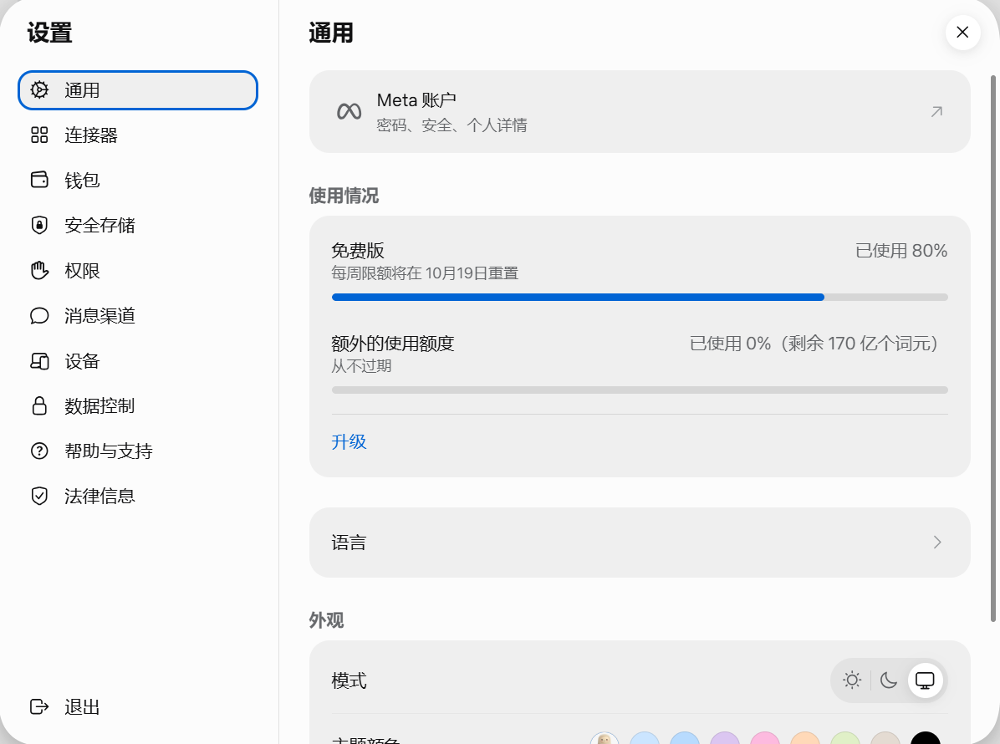

# zhz的折腾过程

## 想法的萌生

首先来说一下为什么会想着重新搭建一个博客，是因为原本的不好吗？当然有一定的原因，但是并不是全部，这里来讲一下我的旧站的维护吧。

旧站采取Fuwari + Cloudflare Pages自托管的模式，是现在的一个性价比很高的搭建方式，**Fuwari 负责提供极致的视觉与性能体验，Cloudflare Pages 负责提供稳定、免费且高速的全球分发**。但是我为什么要放弃呢，其实我想最主要的原因是，目前我的推送流程的阻碍，现在推送的主要流程是：
**本地文件更新** —**git push** — **github push推送** — **Cloudflare pages自动推送** —**部署完成**
看似很好很轻松的过程，但是其中隐含的缺点也有很多：
1. **写作被工具链绑架**：改一个错别字、换一张图，也要走 commit/push/build，灵感场景下很重。
    
2. **反馈链路过长**：push 成功不等于部署成功，还要等构建、看日志、处理失败；故障点分散很难查找。
    
3. **移动端和多设备不友好**：手机上很难完成完整 Git 流程，临时修改只能等电脑。
    
4. **频繁小提交会消耗构建额度**：Cloudflare Pages 免费版 Git 集成有每月构建次数限制，频繁 push 会浪费额度。
但更准确地说：我打算放弃的并不是**Fuwari + Cloudflare Pages**，而是“**每次更新都必须自动触发 Git 构建**”的方式。

**所以我改为了VPS加AI自托管的模式：**

在旧方案里，发布一篇文章本质上是一次**软件部署**：修改文件、commit、push、等待构建、处理构建失败。我的写作意愿被这条链路的摩擦不断消耗。而更新频率也确实如所看到的一样。

在 VPS + AI 托管模式下，发布变成了直接的内容操作。新方案（VPS + AI）通过一个具备操作能力的 AI 代理，直接接管了**发布与运营**这个最消耗精力的环节，完全绕过了 Git 和自动构建。

但是这并不足以让我放弃Fuwari ，这个基于 Astro 框架的静态博客模板，在**设计感和开箱即用的优秀体验**上有着极大的吸引力的一个静态博客。而原因在于我最近经常混迹于各种论坛，也和许多优秀的人交流中不定时的读一读他们的项目经历，在这其中我就发现了一位大佬，他的基于**Firefly**魔改版本的个人网站深深吸引我了 —— [[折腾进行时 - 9LL.UK](https://www.9ll.uk/)  
所以我也萌生了魔改的想法，附上HY站长的几张siteshot：

经过调查我发现：

Firefly 直接把评论、说说/动态做成了内置的功能。根据一些迁移者的对比，它**内置了评论系统、说说/动态、赞助页面和实验室/工具**，大部分定制都可以通过配置文件完成，不再需要魔改核心代码。对我来说，这意味着 AI 可以操作和发布的“内容类型”变多了——它不仅能写文章，还能直接处理动态、管理内置评论，而不需要我先花时间搭建这些基础设施。这里要致敬一下**大佬**——[[[夏夜流萤 - 飞萤之火自无梦的长夜亮起，绽放在终竟的明天。](https://blog.cuteleaf.cn/)]]

## 将调研成果实际落地

一个很直接的证据是，社区里已经出现了专门适配 Firefly 的 **AI Agent Skill**（`firefly-post-writing`）。这个技能让 AI 能够按照 Firefly 的内容集合（Content Collections）规范，自动将 Markdown 内容放入 `src/content/posts/` 下的正确位置，并生成符合其 schema 的 frontmatter（标题、日期、标签、分类等）。这意味着你的 AI 托管不需要自己去摸索 Firefly 的文件结构，可以直接调用现成的技能来完成发布，降低了 AI 操作出错的概率。链接：[firefly-post-writing Agent Skill | GodBlf/godblf.github.io](https://skillsmp.com/zh/creators/godblf/godblf.github.io/agents-skills-firefly-post-writing)

那有了这些基础，选哪个模型呢？我想起来前几天白嫖了 170亿 token 的 **Muse**，Meta 旗下刚出的类似沙盒功能的 AI 助手，平时只帮助我处理一些 Outlook 邮件。评估一下折腾项目的评分，这次为何不**挑战**一下自己呢？

（PS:现在想想有点胡闹了）

然而，这次博客重构，我决定拿它当主力，看看一个 AI Agent 到底能不能独立扛下一个完整的建站项目。

我要的不是一个能聊天的模型，而是一个能动手干活的助手：读写文件、跑构建脚本、调 GitHub API、看日志、修 bug。Muse 的定位正好包含这些吧？是这个吗？。

现在给出结论：**能，但是真的很累。**
## 实战：从 Fuwari 到 Firefly 的迁移

### 选型

Firefly 是 CuteLeaf 基于Astro写的博客主题，Fuwari 的继任者。选它有三个原因：

1. **配置集中化**：所有定制项都在 `src/config/` 下，十几个 TypeScript 配置文件，改配置就能换脸，不用动核心代码
2. **功能内置**：评论、动态、赞助页、实验室都是内置的，Fuwari 时代要自己搭的，Firefly 直接给了
3. **AI 友好**：目录结构清晰，`src/content/posts/` 放文章，`src/content/dynamic/` 放动态，AI 读写不容易出错

HY 站长（9ll.uk）的魔改版是我的视觉目标：卡片式布局、3px 纯黑边框、青绿色主题（hue 174）。我没直接抄代码，只定了视觉规范，让 Muse 按这个调。

### 迁移过程

**第一步：内容迁移**

旧站 11 篇文章 + About 页，直接拷到 `src/content/posts/`。Fuwari 和 Firefly 的 frontmatter 大体兼容，`title`、`published`、`tags`、`category` 都能直接用。有问题的手动修——比如图片路径，Fuwari 用 `./1.jpg`，Firefly 推荐用 `./images/` 子目录，但实测发现 Fuwari 的构建认不出子目录（这个后面单独说）。

**第二步：视觉定制**

按 HY 风格改了这几处：
- 全站 hue 174 青绿，卡片 3px 纯黑边框
- 首页可拖拽贴纸（4 张 AI 生成的图，`src/config/stickerConfig.ts`）
- Live2D：雪初音（主）+ 金发 z16（右），桌面端显示
- 轮播图按横竖版分离：横版放桌面，竖版放手机

### 魔改过程：Firefly 的配置分层

Firefly 相比 Fuwari 最大的变化，是把魔改分成了两层。理解这两层，就理解了怎么在不碰核心代码的情况下，把站点改成 HY 那味。

**第一层：配置驱动（零代码改动）**

所有定制项集中在 `src/config/` 下，十几个独立的 TypeScript 文件：

- `siteConfig.ts`：站点标题、描述、URL。我的站名 "Alexander"，横幅 "Lovely Life"
- `navBarConfig.ts`：顶部导航。我在"我的"下拉里加了 Steam（番组计划下面）、书签分组
- `profileConfig.ts`：侧边栏个人卡。名字 "zhz"，bio "Hello, I'm zhz."
- `commentConfig.ts`：评论系统。切到 Waline，`waline.lanerc.me`
- `backgroundWallpaper.ts`：背景壁纸模式
- `stickerConfig.ts`：首页可拖拽贴纸（我自研的，4 张 AI 图）

这一层覆盖了 80% 的视觉差异。HY 站的卡片布局、配色，基本都是改配置就能实现。AI 改这一层最安全——改错了也只是显示问题，不会构建失败。

**第二层：组件与样式微调**

配置搞不定的，才进 `src/components/` 和样式层：

- 统计页（`src/pages/analytics.astro`）：HY 式卡片，加了 GitHub 推送热力图、数据卡。卡片视觉冻结后只改数据层，整体的Umami数据拉取还是不尽人意。
- Steam 页（`src/pages/steam.astro`）：照着 HY 的 steam 页抄的布局（玩家卡 + 统计卡 + 游戏网格），配色换成咱的青绿 `oklch(0.65 0.15 174)`
- 全站 hue 174、卡片 3px 纯黑边框：在全局样式里定的

这一层我让 Muse 打下手，但主要板权在我。AI 生成 diff，我 review 后再合——它今天就因为多手改了不该改的，被我骂了四次。（**一共让我生气了不下16次了吧，应该是。。没数到，反正最后的包体来到了117版**）

**两层之间的边界**

内容层（`src/content/`）AI 全权负责写，配置层（`src/config/`）AI 改完我要看一眼，组件层（`src/components/`、`src/pages/`）AI 只给建议不动手。这个边界是血泪教训：v108 那次 AI 自作主张换了头像文件，差点把友链的头像地址搞崩。

**第三步：评论系统**

从 Artalk 换回 Waline（Artalk 2.10.0 停服了）。Waline 跑在 HK 机 Docker 里，`127.0.0.1:8360`，SQLite 存数据。配了个 AI 自动回复 `zhz-ai`——访客留言后，跑在 ID 机上的 Python 服务（智谱 glm-4-flash）60 秒轮询一次，自动回评论。昵称显示 `zhz-ai` + 🤖 勋章，回复内容自称"zhz"。

**第四步：统计系统**

Umami 自托管，跑在 HK 机 Docker（`127.0.0.1:8362`）。前端不直连，走了三层：
1. 构建时 `scripts/fetch-umami-stats.py` 拉一份静态数据兜底
2. HK 机 cron 每 5 分钟生成 `/api/stats.json`
3. 前端优先读 `/api/stats.json`，8 秒超时后降级读构建时数据

统计页还加了 GitHub 推送热力图（构建时 `scripts/fetch-github-activity.py` 拉 52 周 commit 数据）。

*整体上效果待定吧，这个也是以后修改的一个方向*
## 踩坑记录

**1：Fuwari 图片子目录**

新文章的图片放在 `images/` 子目录，`./images/img22.png` 这种引用，Fuwari 构建直接报 `ImageNotFound`。旧站 11 篇文章都是图片放根目录，Fuwari 的 Astro 配置认不出子目录。总结了一下：**同步到旧站的文章，图片必须打平**，`./images/X` 改成 `./X`。

**2：Cloudflare 构建队列**

用 GitHub API 一篇一篇推文章，每篇一个 commit，Cloudflare Pages 疯狂触发构建，队列堵死，大部分显示 "No deployment available"。后来给AI讲**批量操作要打包**，用 Git Data API 把一篇文章的所有文件打成一个 commit。

**3：Waline 容器 OOM**

HK 机只有 887MB 内存，Waline 的 better-sqlite3 原生模块直接崩了，nginx 报 502。容器自动重启后恢复，但内存还是紧张。把不用的 whatsapp-proxy 停了，也只释放了 6MB。**2C/887MB 跑 Waline + Umami + Postgres 就是勉强**。（后悔没用其他机子了）

**大佬们如果以后光临本站发现评论加载不出来那多半是挂了，访问的人数一多，刷新一多的话香港机子跑的就很勉强了**

**坑 4：Umami 分享 token 调不到 realtime**

统计页的"在线人数"用分享 token 调 `/api/realtime/` 返回 401。排查发现是前端 localStorage 缓存了过期的 token，换了缓存 key（v2）强制刷新后解决。

**这个部分是AI做的最差的部分，目前解决起来确实很困难，但是访客视觉上不会收到太大影响。**

### AI 托管的工作流

现在的工作流是：

我在聊天里下指令/提交推文  
→ Muse 写 Markdown 到 src/content/posts/  
→ Muse 跑 ./build.sh（8 步：清缓存 → 拉 Umami → 拉 Steam → 拉 GitHub → 建索引 → AI 摘要 → Astro 构建 → Pagefind）（**够复杂**！！）  
→ 打包 dist（148MB，split 成 80M 两卷）  （**免费版最大了吗**？）
→ 我手动在 HK 机部署（curl 下载 → 解压 → chmod → purge CF 缓存）

其实这个流程也很糟心，主要是**Muse应对魔改的需求还是太勉强了**，其实很大部分是因为VPS的问题，**跑不起那些Muse改的再好也是落地实现不了**。

AI 负责写和构建，我负责部署和构思采用。配置层（`src/config/`）的改动我人工确认，内容层（`src/content/`）AI 直接写。这个边界守住的话，AI 再抽风也只影响文章，不会把站点布局搞崩。（当然他天生不是这么智能，已经把站点搞崩了3次了吧，**印象中**）`firefly-post-writing` 的护栏本身也体现了这个倾向：它要求 AI 不去改动非内容配置文件，不删除必需的 frontmatter，保持日期格式稳定。

# 致谢

 [9LL.UK](https://9ll.uk/) 
 [夏夜流萤 - 飞萤之火自无梦的长夜亮起，绽放在终竟的明天。](https://blog.cuteleaf.cn/)

# 附录

这几天烧了这么多token，Muse的量还是大啊。用不完**根本用不完**！

